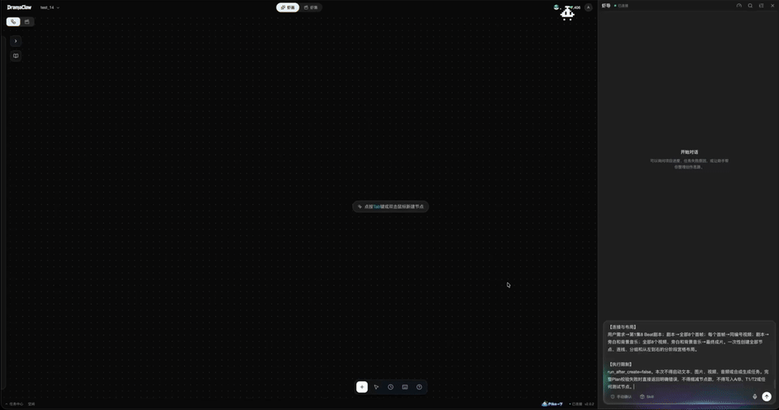
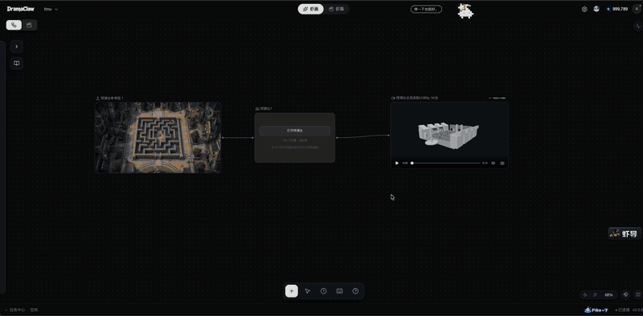
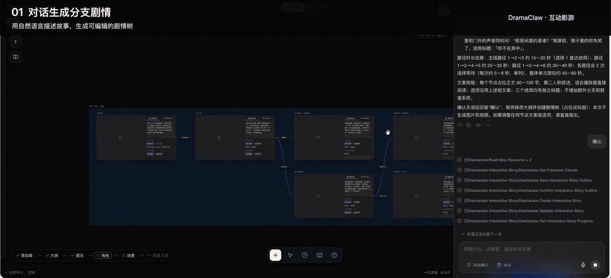
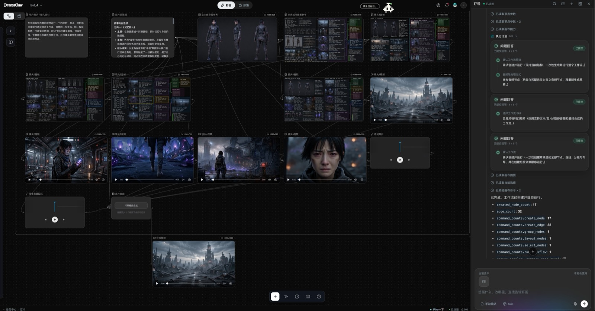
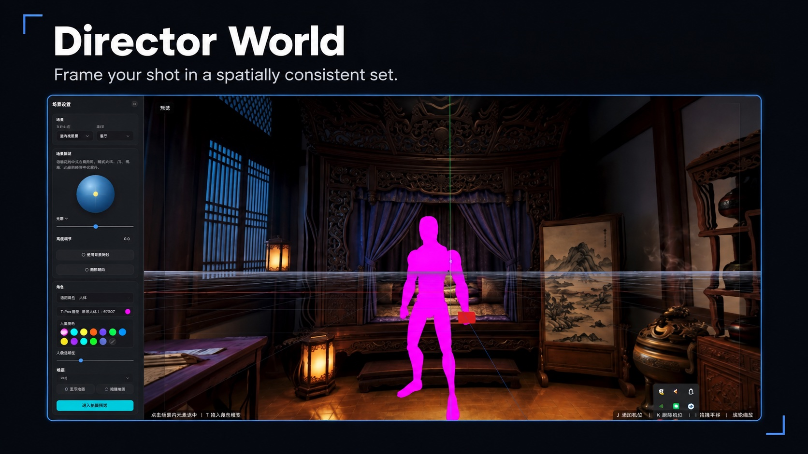
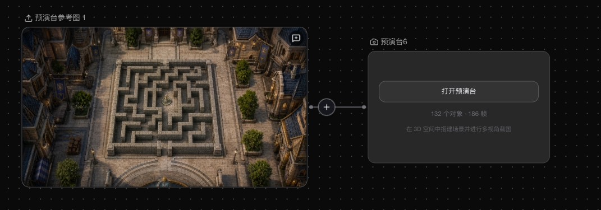
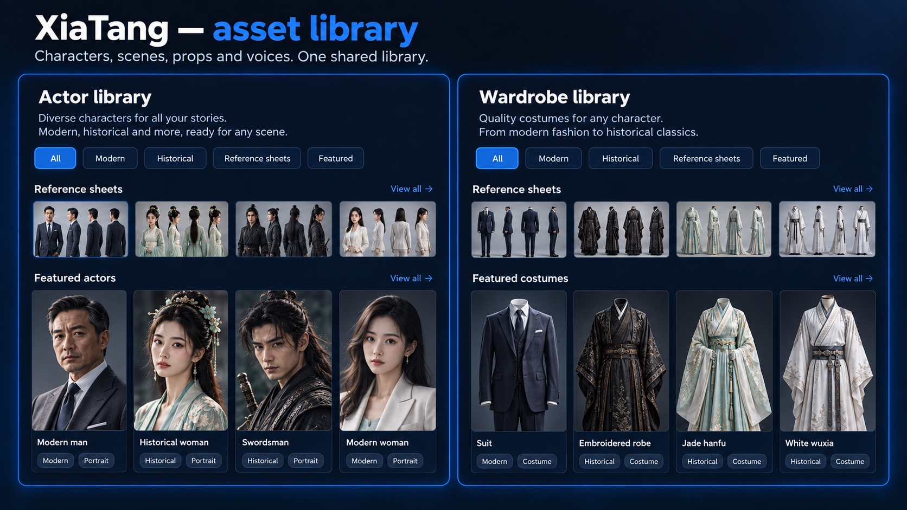
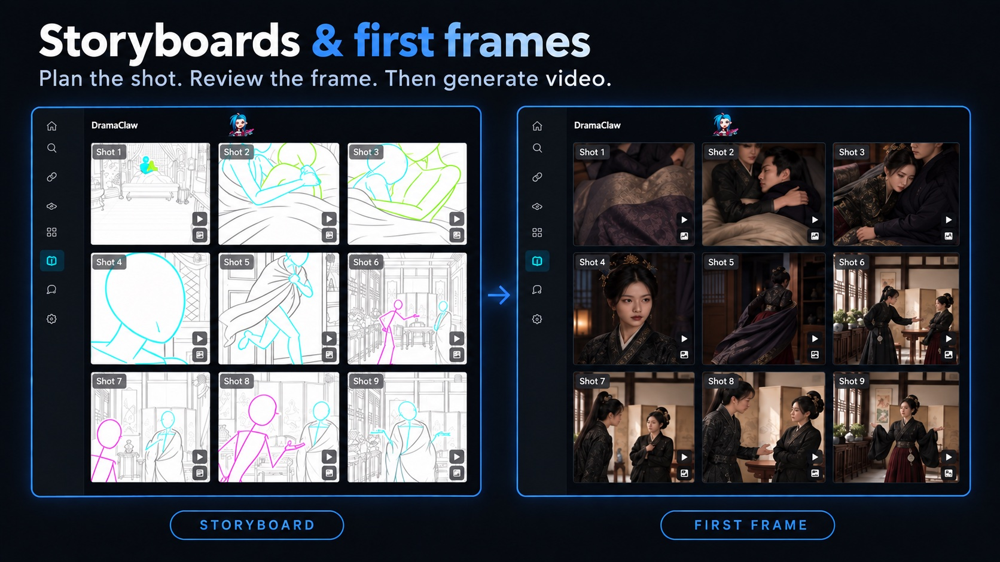

<div align="center">

<!-- TBD: replace with official logo assets/logo.svg -->
<h1>DramaClaw</h1>

## Make Your Own DC.

<p align="left">

They say you're obsolete.<br/>
Maybe it's the whole idea of "working for someone else" that's obsolete.<br/>
<br/>
In the age of AI, the real question isn't whether machines replace people.<br/>
The real question is:<br/>
Who owns the machines?<br/>
Who owns the pipeline?<br/>
Who owns industrialized productivity?<br/>
<br/>
If the answer is always Big Tech,<br/>
then AI isn't empowerment.<br/>
It's just a new wall.<br/>
<br/>
I'm Eric.<br/>
<br/>
This isn't a demo.<br/>
Not a toy.<br/>
Not a crippled edition.<br/>
<br/>
This is the industrialized drama-production line our own team runs every day.<br/>
From script to storyboard, from assets to finished film — the whole chain.<br/>
<br/>
Because people aren't beasts of burden.<br/>
Because creativity is humanity's last line of defense.<br/>
<br/>
What DramaClaw sets out to do is simple:<br/>
<br/>
<strong>Tear down the wall.</strong><br/>
<br/>
Put the industrialized drama-production power that only Big Tech had<br/>
into the hands of ordinary creators.<br/>
<br/>
The code is here.<br/>
If this resonates, leave a ⭐.<br/>
We'll keep tearing down walls.

</p>

<p align="left">

<strong>And yes, you can make money with it.</strong><br/>
DramaClaw is <a href="./LICENSES/Elastic-2.0.txt">Elastic License 2.0</a>. Run it, modify it, sell what you build with it —<br/>
the standalone version is free for commercial use, no permission needed.<br/>
We ask for one thing: a small "Powered by DramaClaw" in the corner of your UI.<br/>
The only door still closed is wrapping it up as a hosted SaaS for other people; that license isn't open yet.<br/>
Why, and the FAQ: <a href="https://github.com/dramaclaw/dramaclaw/issues/475">#475</a>.

</p>

<br/>

[](./LICENSES/Elastic-2.0.txt)
[](https://github.com/dramaclaw/dramaclaw/stargazers)
[](https://github.com/dramaclaw/dramaclaw/releases)
[](#quick-start)

**English** &nbsp;|&nbsp; [简体中文](./readme/README_zh.md) &nbsp;|&nbsp; [Tiếng Việt](./readme/README_vi.md) &nbsp;|&nbsp; [ไทย](./readme/README_th.md) &nbsp;|&nbsp; [Website](https://dramaclaw.ai) &nbsp;|&nbsp; [Docs](./docs/en/README.md) &nbsp;|&nbsp; [Quick Start](./docs/en/getting-started/quickstart.md)

</div>

<br/>

<p align="center">
  
</p>

<p align="center">
  <sub>🎬 Trailer: <a href="https://www.bilibili.com/video/BV1iQV26cE4S">Bilibili</a> &nbsp;·&nbsp; <a href="https://www.youtube.com/watch?v=64apa3maxK0">YouTube</a></sub>
</p>

<br/>

## What is DramaClaw?

DramaClaw is a **self-hostable production line for AI drama**: from manuscript to finished episodes, and from a one-line brief to a short film. An agent and an infinite canvas share one asset library:

- **Xia Director** — the built-in agent. Describe what you want; it plans the workflow, lays out the nodes and runs them with your confirmation.
- **XiaHua** — the infinite canvas. Generate, edit and connect images, video, audio, 3D sets, interactive stories and scripts as nodes.
- **Series (XiaJi)** — the pipeline. Drop in a novel or screenplay; DramaClaw structures the story, writes scripts, draws storyboards, voices the lines and cuts the film.

Bring any model through an OpenAI-compatible gateway, run it on your own machine, and keep your material.

<p align="center">
  <a href="#quick-start"><b>🚀 Quick Start</b></a> &nbsp;·&nbsp;
  <a href="#whats-new"><b>🆕 What's New</b></a> &nbsp;·&nbsp;
  <a href="#made-with-dramaclaw"><b>🎬 Showcase</b></a> &nbsp;·&nbsp;
  <a href="#features"><b>✨ Features</b></a> &nbsp;·&nbsp;
  <a href="#models"><b>🔌 Models</b></a> &nbsp;·&nbsp;
  <a href="#documentation"><b>📖 Docs</b></a>
</p>

<br/>

## <a name="whats-new"></a>🆕 What's New

Three things we have been building with our own production team, now in `main`.

### 🤖 Xia Director — from a brief to a running workflow

<p align="center">
  
</p>
<p align="center"><sub>One brief → planned workflow → nodes on the canvas → generated assets → composed video.</sub></p>

- **Plans and runs canvas workflows** — turns a creative brief into a node graph, lays it out, and executes it after you confirm, with progress tracking and failure recovery.
- **Workflow catalog, Skills and Recipes** — built-in workflows for short drama, e-commerce and IP character ads, social content, Japanese anime, LEGO-style animation and outdoor stage duels. Install, export and share Skill bundles, or **import an external `SKILL.md` / ZIP** and convert it into a native Skill.
- **Builds web pages too** — ask for a landing page or story microsite; it becomes an editable HTML node with revision history and a self-contained ZIP export.
- **Knows your project** — checks progress, advances script and shot tasks, finds missing deliverables and suggests what to do next.
- **Your choice of brain** — ships with a bundled Codex runtime by default; point the Agent at any third-party model that supports the OpenAI Responses API and tool calls, independent of your media channels.
- **Works from other agents** — [Agent Kit](agent-kit/README.md) exposes the same workflows over MCP to Codex, Claude Code, OpenClaw, WorkBuddy and any stdio MCP client.

### 🎥 3D Previz Stage — block the scene before you generate it

<p align="center">
  
</p>
<p align="center"><sub>Reference image → 3D blockout → characters, cameras and timeline → recorded preview back on the canvas.</sub></p>

An in-browser previs stage that lives on the canvas as a node. Lock down space, blocking and framing first, then feed the result to image and video generation.

- **Scene blockout** — generate a 3D scene from a reference image; drop props and they land on whatever surface is underneath.
- **Characters and motion** — mannequins in five builds, placed from a top-down map; walk cycles that follow movement paths on a multi-track timeline.
- **Cameras and cutting** — focal length, sensor size and placement per camera; a **program track** to cut between cameras (digit keys cut live) with the monitor following the edit.
- **Audio track** — import audio from a local file or an upstream node, see waveforms, and mix it into recordings.
- **Back to the canvas** — capture frames or record the program cut into connected nodes as references for the next generation.

### 🔀 Interactive Stories — audience choices shape the story

<p align="center">
  
</p>
<p align="center"><sub>Branching story generation, canvas authoring, interactive playback and multiple endings.</sub></p>

- **AI story planning** — a brief becomes an outline and an editable branching narrative with choice points, endings and estimated runtime per route.
- **Visual branching on the canvas** — arrange segments, videos and choices; edit dialogue, choice order and branch connections.
- **Variables and conditions** — affinity, scores and other variables gate choices and decide endings; timed choices and default routes included.
- **Produce media in place** — character, scene and storyboard references and per-segment videos, reusing every canvas asset.
- **Playtest before rendering** — run the story with placeholder media, validate branch connectivity and conditional paths, inspect ending reach rates and path coverage.
- **Ship a player** — export a standalone HTML player or an offline package with video, branching playback, progress and replay.

<br/>

<div align="center">

## <a name="made-with-dramaclaw"></a>🎬 Made with DramaClaw

<sub>Real short dramas our team produced on this very pipeline &mdash; click a link to play.</sub>

<table>
  <tr>
    <td align="center" width="205" valign="top">
      <br/>
      <b>归灵司</b><br/>
      <a href="https://nfg-web-assets.cdnfg.com/dramaclaw/guilingsi/guilingsi-ep01.mp4">▶ 第 1 集</a>
    </td>
    <td align="center" width="205" valign="top">
      <br/>
      <b>鲁班</b><br/>
      <a href="https://nfg-web-assets.cdnfg.com/dramaclaw/luban/luban-ep01.mp4">▶ 第 1 集</a>
    </td>
    <td align="center" width="205" valign="top">
      <br/>
      <b>师兄你怎么不舔了</b><br/>
      <a href="https://nfg-web-assets.cdnfg.com/dramaclaw/shixiong-butianle/shixiong-butianle-ep01.mp4">▶ 第 1 集</a>
    </td>
  </tr>
  <tr>
    <td align="center" width="205" valign="top">
      <br/>
      <b>天命不可欺</b><br/>
      <a href="https://nfg-web-assets.cdnfg.com/dramaclaw/tianmingbukeqi/tianmingbukeqi-ep02.mp4">▶ 第 02 集</a> &nbsp;·&nbsp; <a href="https://nfg-web-assets.cdnfg.com/dramaclaw/tianmingbukeqi/tianmingbukeqi-ep58.mp4">第 58 集</a>
    </td>
    <td align="center" width="205" valign="top">
      <br/>
      <b>乌龙仙途</b><br/>
      <a href="https://nfg-web-assets.cdnfg.com/dramaclaw/wulongxiantu/wulongxiantu-ep01.mp4">▶ 第 1 集</a>
    </td>
    <td align="center" width="205" valign="top">
      <br/>
      <b>非遗㑇舞</b><br/>
      <a href="https://nfg-web-assets.cdnfg.com/dramaclaw/feiyi-zhouwu/feiyi-zhouwu.mp4">▶ 播放</a>
    </td>
  </tr>
</table>

<sub>More clips:
<a href="https://nfg-web-assets.cdnfg.com/dramaclaw/3d-anime-montage-demo/3d-anime-montage-demo.mp4">3D 动漫混剪 demo</a> &nbsp;·&nbsp;
<a href="https://nfg-web-assets.cdnfg.com/dramaclaw/dongtai-dadou/dongtai-dadou.mp4">动态打斗</a></sub>

</div>

<br/>

## <a name="quick-start"></a>🚀 Quick Start

You need Docker with `docker compose`. No GPU, database or queue is required — models run behind the gateway, state lives on local disk.

```bash
git clone https://github.com/dramaclaw/dramaclaw.git
cd dramaclaw
cp .env.example .env          # set PROMPT_EXPORT_PASSWORD to a non-default value

docker compose -f docker-compose.release.yml pull
docker compose -f docker-compose.release.yml up -d
```

Open <http://localhost:8080>, go to **Settings → Models & Channels**, and paste your DC key (get one at <https://relayclaw.cdnfg.com>) — or switch to **Custom** to use your own providers. That's it.

The release Compose file runs the published **v2.1.1** multi-arch images (`DRAMACLAW_VERSION=2.1.1`, `DRAMACLAW_GATEWAY_VERSION=v1.0.0-rc.24-dramaclaw.3`). Mainland China users can switch to the ACR mirror with `DRAMACLAW_IMAGE_PREFIX`.

<details>
<summary><b>Other ways to run it</b></summary>

<br/>

| Method | When to use | Command | Guide |
|---|---|---|---|
| **Published images** | Try or self-host a release | `docker compose -f docker-compose.release.yml up -d` | [Quick Start](docs/en/getting-started/quickstart.md) |
| **Source Docker** | Run your own modified code | clone [dramaclaw-gateway](https://github.com/dramaclaw/dramaclaw-gateway) next to this repo, then `docker compose up -d --build` | [Self-hosting](docs/en/guides/self-hosting.md) |
| **Local dev** | Hack on DramaClaw with hot reload | `scripts/start-ce.sh` (API `:8780` + UI `:5173`; needs Python 3.11–3.12, `uv`, Node/pnpm, `ffmpeg`) | [Installation](docs/en/getting-started/installation.md) |

`scripts/start-ce.sh` downloads the patched Codex **0.164.0** Agent runtime for macOS or Linux, verifies its pinned SHA256, and caches it under `runtime/codex/bin/`. Set `CODEX_BIN` in `.env` to use your own patched build instead; Windows users should use WSL2 or Docker.

Upgrading from an older checkout, pinning versions, exposing the bundled gateway, or using your own Codex binary: see the [Self-hosting guide](docs/en/guides/self-hosting.md) and [Troubleshooting](docs/en/guides/troubleshooting.md).

</details>

<details>
<summary><b>System requirements</b></summary>

<br/>

| Item | Requirement |
|---|---|
| **CPU / RAM** | ≥ 2 vCPU / 4 GB (model inference runs on the gateway, not locally) |
| **GPU** | Not required. Only the optional `world` extra (voxel / panorama-to-3D) needs CUDA |
| **OS** | macOS (Apple Silicon / Intel), Windows (Docker Desktop + WSL2), Linux |
| **Ports** | `8080` web UI · `8780` REST API · `3000` bundled gateway admin (localhost only by default) |
| **Datastores** | None — no Postgres, Redis, Celery or Ray. SQLite + files on the `ce-data` volume |
| **Network** | Outbound access to `relayclaw.cdnfg.com` and/or the providers you configure |

</details>

<br/>

## <a name="features"></a>✨ Features

### XiaHua — the infinite canvas

<p align="center">
  
</p>
<p align="center"><sub>One prompt to Xia Director (right) became this 17-node, 32-edge workflow (left): brief → story direction → character and set references → five first frames → five shot videos → voice-over and score → final cut.</sub></p>

- **One canvas, every medium** — image, video, audio, script, beat context, storyboard, style, skill, 360° panorama, 3D world, Previz, interactive story, web page and export nodes. Connect them freely; every node keeps its own generation history.
- **Image tools** — generate, edit, redraw, outpaint, relight, upscale, multi-view, template edit, reverse-prompt, mark detection, and a **style wall of 45 short-drama looks**.
- **Video tools** — text / image / keyframe to video, omni-reference generation with file, web-link and on-canvas references, video edit, erase, upscale, audio separation, camera templates and shot analysis; Seedance 2.5 in the recommended catalog.
- **Audio and voice design** — speech synthesis, voice library, reference audio and music. **Describe a voice in words**, preview it, and save it to a character slot or **My voices** (needs a compatible audio model and `VOICE_DESIGN_ENABLED=1` with daily limits in [`.env`](.env.example)).
- **Director World** — turn an image into a 3D Gaussian Splat set or a scene-360 panorama, frame the shot in the viewer, and reuse the same location consistently across shots.
- **Built for big canvases** — tabs, outline, minimap, viewport bookmarks, snap-align, level-of-detail rendering, group nodes, shortcuts, revision history with restore and per-canvas locking.
- **Commit to the series** — preview the impact, then promote a node or a batch into the asset library or an episode; project the series back onto a canvas.

<table>
  <tr>
    <td width="50%"><p align="center"><sub>Director World</sub></p></td>
    <td width="50%"><p align="center"><sub>Previz node on the canvas</sub></p></td>
  </tr>
</table>

### Series (XiaJi) — the pipeline

<p align="center">
  
</p>

Every stage is an independent task with its own interface — run them in order, skip steps, resume from any checkpoint, or drive them from your own orchestrator.

- **Structured ingest** — episodes, characters and scenes straight from a manuscript or screenplay (Fountain supported); no knowledge graph or embeddings required.
- **Asset library (XiaTang)** — characters, scenes, props and voices organized by purpose; stable identities across episodes, portraits and per-episode variants.
- **Episode planning and scripts** — chapter segmentation, beat planning, multi-episode arcs; adaptive / literal / staged script modes with review-and-repair loops.
- **Storyboards and first frames** — beat-driven stylized generation, grid splitting, image-pool selection.
- **Voice-over, composition and export** — emotion-aware speech, episode assembly, video + subtitle export and the full asset pack.
- **Visual style** — extract style parameters from a reference image and apply them project-wide.
- **Task Center** — status, progress, logs, cancel / retry and resume-from-checkpoint for long runs.

<table>
  <tr>
    <td width="50%"><p align="center"><sub>XiaTang — asset library</sub></p></td>
    <td width="50%"><p align="center"><sub>Storyboards and first frames</sub></p></td>
  </tr>
</table>

<br/>

## 🤔 Why DramaClaw?

- **A canvas that understands drama, and an agent that works on it.** Generic node canvases wire anything together but know nothing about episodes, characters or shots. DramaClaw's nodes and Skills do, and Xia Director plans and runs them for you.
- **Canvas *and* pipeline.** Explore freely on the canvas, commit what works to the series, project the series back onto a canvas — one asset library, one agent.
- **No black box.** Every stage is a decomposable task with its own API. Skip, resume, replace or script any step.
- **Self-hostable and model-neutral.** Your manuscript, your characters, your models, your servers. Use frontier closed models or open-weight ones; switch any time.

### How DramaClaw compares

<sub>Legend: ✅ Full · ◐ Partial · ○ Planned · ❌ None · — Not verified. Competitor names partially masked; based on publicly available product docs and positioning.</sub>

| Capability | L\*TV | R\*Hub | T\*Now | S\*ko | U\*dream | O\*II | J\*/K\* | **DramaClaw** |
|---|:--:|:--:|:--:|:--:|:--:|:--:|:--:|:--:|
| Built-in agent (workflow planning, canvas orchestration, execution) | ✅ | ✅ | ✅ | ○ | ✅ | ○ | ✅ | ✅ |
| Workflow Skills and Recipes (reuse, import, export, share) | — | — | — | — | — | — | — | ✅ |
| 3D previz stage (blocking, motion, cameras, timeline, recording) | — | — | — | — | — | — | — | ✅ |
| Interactive series (branching, variables, multiple endings) | ◐ | ◐ | ◐ | ✅ | ◐ | ❌ | ❌ | ✅ |
| Infinite canvas (node-based, free exploration) | ✅ | ✅ | ✅ | ❌ | ✅ | ✅ | ✅ | ✅ |
| Dual-track (main pipeline + canvas exploration) | ❌ | ❌ | ❌ | ❌ | ❌ | ❌ | ❌ | ✅ |
| Storyboard preview (script → shots, boards) | ◐ | ✅ | ◐ | ✅ | ◐ | ❌ | ❌ | ✅ |
| Asset library (characters / scenes / props / voices) | ◐ | ❌ | ◐ | ✅ | ◐ | ○ | ❌ | ✅ |
| Scene consistency (variants, 360°, multi-state) | ✅ | ◐ | ❌ | ❌ | ○ | ❌ | ❌ | ✅ |
| Director's world (360° / 3D set, camera, framing) | ✅ | ◐ | ❌ | ❌ | ◐ | ❌ | ❌ | ✅ |
| Final delivery (multi-shot, subtitles / SRT, pack) | ✅ | ○ | ○ | ✅ | ✅ | ❌ | ❌ | ✅ |
| Team production (sharing, roles, tasks, cost) | ✅ | ✅ | ○ | ✅ | ○ | ○ | ○ | ✅ |
| Custom style (templates, prompts, negatives) | ✅ | ◐ | ○ | ✅ | ◐ | ○ | ◐ | ✅ |
| Creative companion (persona, nudges, feedback) | ❌ | ❌ | ❌ | ❌ | ❌ | ❌ | ❌ | ✅ |
| Source-available (self-host, fork, customize) | ❌ | ❌ | ❌ | ❌ | ❌ | ❌ | ❌ | ✅ |

<br/>

## <a name="models"></a>🔌 Models & Providers

All text, image, video and audio models connect through an **OpenAI-compatible gateway**. Pick a mode in **Settings → Models & Channels**:

| Mode | What you do | Best for |
|---|---|---|
| **Official** (recommended) | Paste your DC key from [RelayClaw](https://relayclaw.cdnfg.com). Every model mapping is preconfigured. | Getting started fast |
| **Custom** | One click initializes the bundled [dramaclaw-gateway](https://github.com/dramaclaw/dramaclaw-gateway); add your own provider channels. | Full control over providers and cost |
| **Local + Official Hybrid** | Official models for the pipeline, plus your own channels (e.g. a local ComfyUI workflow). | Mixing in local or niche models |

The bundled gateway is DramaClaw's fork of [New API](https://github.com/QuantumNous/new-api). It speaks the DC-Media contract and ships adapters for **ComfyUI · MiniMax / Hailuo · VolcEngine Doubao / Seedance · fal.ai · Alibaba · Kling · Jimeng · Vertex AI · Gemini · OpenAI / Sora · Suno** ([support matrix](https://github.com/dramaclaw/dramaclaw-gateway/blob/main/docs/providers/en/README.md), [add a provider](https://github.com/dramaclaw/dramaclaw-gateway/blob/main/CONTRIBUTING.md)).

The Agent model is configured separately under **Models & Channels → Agent model** and can follow the active channel or use any endpoint that supports the OpenAI Responses API with tool calls. Details: [Configuring models](docs/en/getting-started/configuring-models.md).

<br/>

## <a name="documentation"></a>📖 Documentation

| | |
|---|---|
| **Start** | [Quick Start](./docs/en/getting-started/quickstart.md) · [Installation](./docs/en/getting-started/installation.md) · [Configuring models](./docs/en/getting-started/configuring-models.md) |
| **Learn** | [Feature overview](./docs/en/concepts/features.md) · [Architecture](./docs/en/concepts/architecture.md) · [Product manual (Feishu)](https://neo-flying.feishu.cn/docx/JGNTdsjJuo748TxJkxecoYs2nth) |
| **Operate** | [Self-hosting](./docs/en/guides/self-hosting.md) · [Troubleshooting](./docs/en/guides/troubleshooting.md) · [Use from Claude Code (MCP)](./docs/en/guides/mcp-claude-code.md) |
| **More** | [All docs &rarr;](./docs/en/README.md) |

<br/>

## 🤝 Community & Contributing

- 🐛 [Report a bug](https://github.com/dramaclaw/dramaclaw/issues/new?template=bug_report.yml) · 💡 [Request a feature](https://github.com/dramaclaw/dramaclaw/issues/new?template=feature_request.yml) · 💬 [Discussions](https://github.com/dramaclaw/dramaclaw/discussions)
- Read the [Contributing guide](./CONTRIBUTING.md) and [Security policy](./SECURITY.md); start with a [`good first issue`](https://github.com/dramaclaw/dramaclaw/labels/good%20first%20issue).

<br/>

## Produced By

<p align="center">
  <picture>
    <source media="(prefers-color-scheme: dark)" srcset="./assets/partners/neoflying-lab-dark.png">
    
  </picture>
</p>

<p align="center"><sub>Logo is a trademark of its respective owner, shown with permission.</sub></p>

<br/>

## License

[Elastic License 2.0](./LICENSES/Elastic-2.0.txt). Free to use, modify, redistribute and sell what you build with it; keep a small "Powered by DramaClaw" in your UI. The only restriction is that you may not offer the software itself as a hosted service to others. See the [license explainer](./docs/en/license.md), the [licensing statement](https://github.com/dramaclaw/dramaclaw/issues/475), and `NOTICE` for required branding and third-party attributions.

<br/>

## Star History

<a href="https://www.star-history.com/?repos=dramaclaw%2Fdramaclaw&type=date&legend=top-left">
 <picture>
   <source media="(prefers-color-scheme: dark)" srcset="https://api.star-history.com/chart?repos=dramaclaw/dramaclaw&type=date&theme=dark&legend=top-left&sealed_token=CWTXgm9EqgQmnSFWk0inuf_iZSml5r1nclyIsUyisWgYhUzFVJdI8G61vyFACIQe14weeMtjWSxpkzWdtFqyb93uV4uaRElaXWQv2kFxFFyL8KbUQBCOBUWXDtZc81J8YlaSiBVVXeOygLYZliOK4VQo4i1Ioqkxn5js-Bq0gbqVOH_wF3GCQ_EnMGLy" />
   <source media="(prefers-color-scheme: light)" srcset="https://api.star-history.com/chart?repos=dramaclaw/dramaclaw&type=date&legend=top-left&sealed_token=CWTXgm9EqgQmnSFWk0inuf_iZSml5r1nclyIsUyisWgYhUzFVJdI8G61vyFACIQe14weeMtjWSxpkzWdtFqyb93uV4uaRElaXWQv2kFxFFyL8KbUQBCOBUWXDtZc81J8YlaSiBVVXeOygLYZliOK4VQo4i1Ioqkxn5js-Bq0gbqVOH_wF3GCQ_EnMGLy" />
   
 </picture>
</a>

<br/><br/>

<div align="center">
  <sub>Built for storytellers. Source, open to all.</sub>
</div>
