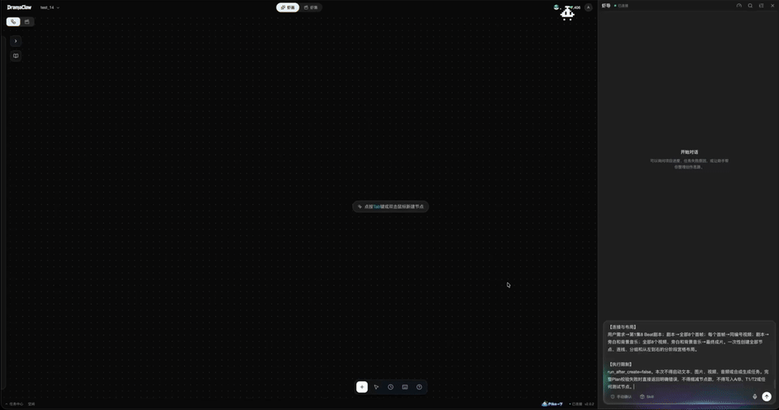
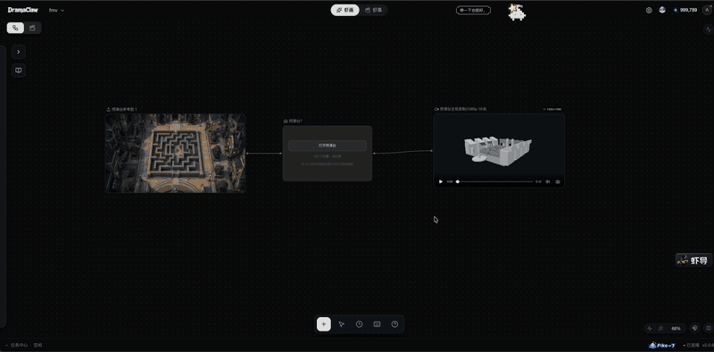
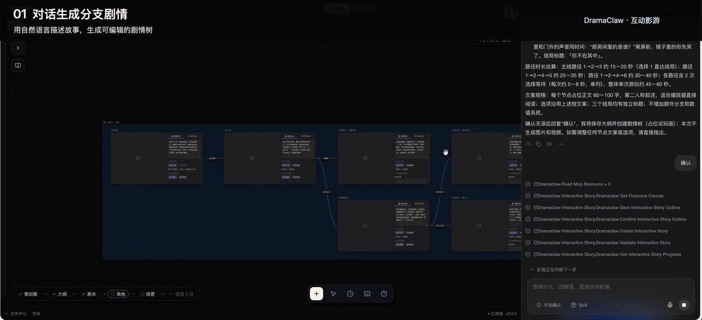
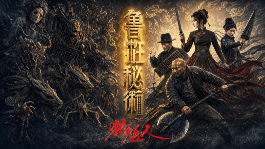
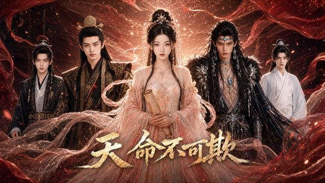
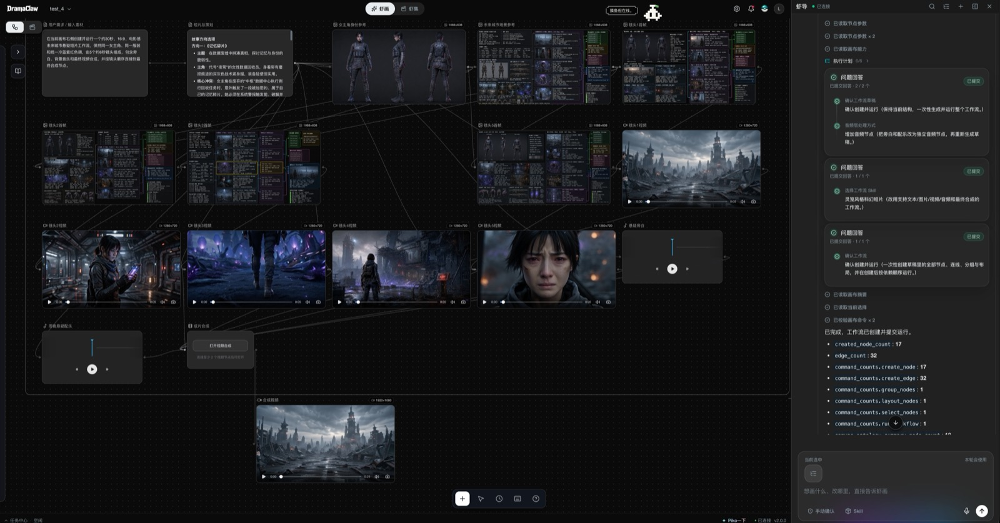
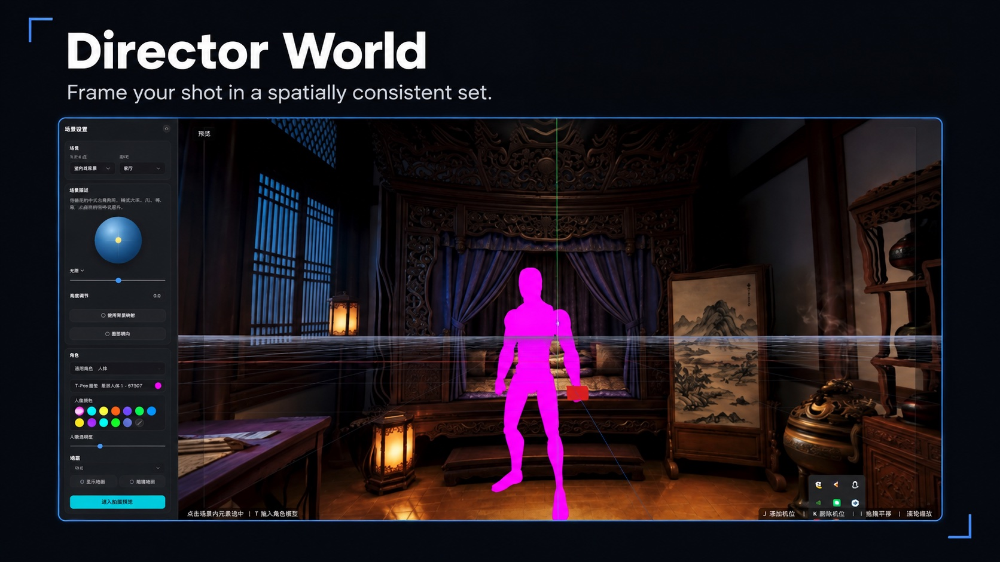
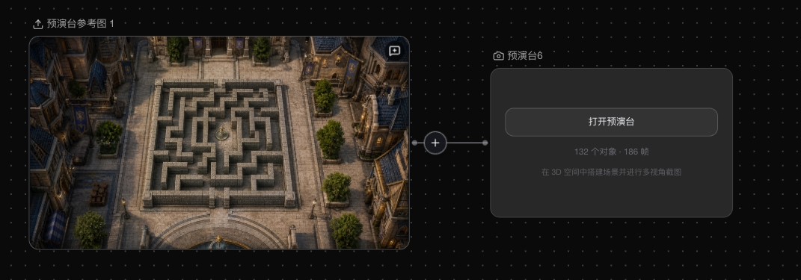
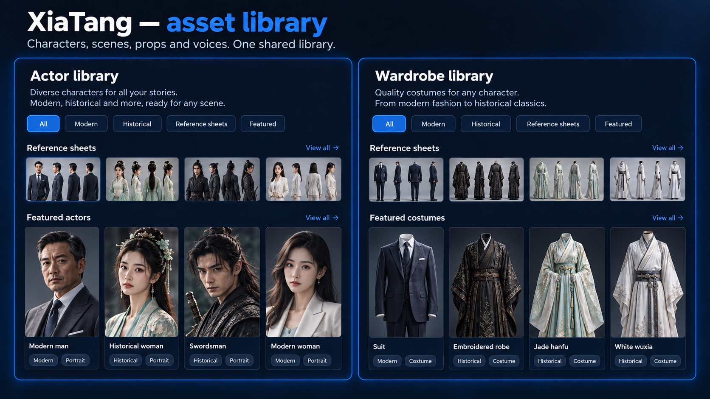
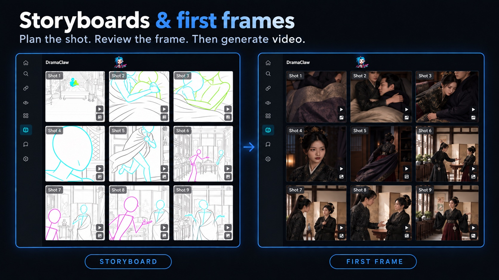

<div align="center">

<!-- TBD: replace with official logo assets/logo.svg -->
<h1>DramaClaw</h1>

## Make Your Own DC.

<p align="left">

เขาบอกว่าคุณล้าสมัยแล้ว<br/>
บางทีสิ่งที่ล้าสมัยจริง ๆ อาจเป็นแนวคิด "ทำงานให้คนอื่น" ต่างหาก<br/>
<br/>
ในยุค AI คำถามที่แท้จริงไม่ใช่ว่าเครื่องจักรจะมาแทนคนหรือไม่<br/>
คำถามที่แท้จริงคือ<br/>
ใครเป็นเจ้าของเครื่องจักร<br/>
ใครเป็นเจ้าของสายการผลิต<br/>
ใครเป็นเจ้าของกำลังการผลิตแบบอุตสาหกรรม<br/>
<br/>
ถ้าคำตอบคือบริษัทเทคยักษ์ใหญ่เสมอ<br/>
AI ก็ไม่ใช่การมอบอำนาจ<br/>
มันเป็นแค่กำแพงใหม่<br/>
<br/>
ผมชื่อ Eric<br/>
<br/>
นี่ไม่ใช่เดโม<br/>
ไม่ใช่ของเล่น<br/>
ไม่ใช่เวอร์ชันตัดฟีเจอร์<br/>
<br/>
นี่คือสายการผลิตละครแบบอุตสาหกรรมที่ทีมของเราใช้งานจริงทุกวัน<br/>
ตั้งแต่บทไปจนถึงสตอรีบอร์ด ตั้งแต่แอสเซ็ตไปจนถึงหนังที่ตัดเสร็จ — ครบทั้งสายการผลิต<br/>
<br/>
เพราะคนไม่ใช่สัตว์ใช้แรงงาน<br/>
เพราะความคิดสร้างสรรค์คือแนวป้องกันสุดท้ายของมนุษยชาติ<br/>
<br/>
สิ่งที่ DramaClaw ตั้งใจทำนั้นเรียบง่าย<br/>
<br/>
<strong>ทลายกำแพง</strong><br/>
<br/>
นำพลังการผลิตละครแบบอุตสาหกรรมที่เคยมีแต่บริษัทเทคยักษ์ใหญ่เท่านั้น<br/>
มาส่งถึงมือครีเอเตอร์ธรรมดา<br/>
<br/>
โค้ดอยู่ตรงนี้แล้ว<br/>
ถ้าคุณรู้สึกเหมือนกัน ฝาก ⭐ ไว้สักดวง<br/>
เราจะทลายกำแพงต่อไป

</p>

<p align="left">

<strong>และใช่ คุณหาเงินจากมันได้</strong><br/>
DramaClaw ใช้สัญญาอนุญาต <a href="../LICENSES/Elastic-2.0.txt">Elastic License 2.0</a> รันได้ แก้ได้ ขายสิ่งที่คุณสร้างจากมันได้ —<br/>
เวอร์ชัน standalone ใช้เชิงพาณิชย์ได้ฟรี ไม่ต้องขออนุญาต<br/>
เราขอแค่อย่างเดียว: ข้อความเล็ก ๆ "Powered by DramaClaw" ที่มุม UI ของคุณ<br/>
ประตูบานเดียวที่ยังปิดอยู่คือการนำไปห่อเป็น SaaS แบบโฮสต์ให้คนอื่นใช้ สิทธิ์ส่วนนั้นยังไม่เปิด<br/>
เหตุผลและคำถามที่พบบ่อย: <a href="https://github.com/dramaclaw/dramaclaw/issues/475">#475</a>

</p>

<br/>

[](../LICENSES/Elastic-2.0.txt)
[](https://github.com/dramaclaw/dramaclaw/stargazers)
[](https://github.com/dramaclaw/dramaclaw/releases)
[](#quick-start)

[English](../README.md) &nbsp;|&nbsp; [简体中文](./README_zh.md) &nbsp;|&nbsp; [Tiếng Việt](./README_vi.md) &nbsp;|&nbsp; **ไทย** &nbsp;|&nbsp; [เว็บไซต์](https://dramaclaw.ai) &nbsp;|&nbsp; [เอกสาร](../docs/en/README.md) &nbsp;|&nbsp; [เริ่มต้นอย่างรวดเร็ว](../docs/en/getting-started/quickstart.md)

</div>

<br/>

<p align="center">
  
</p>

<p align="center">
  <sub>🎬 ตัวอย่างหนัง: <a href="https://www.bilibili.com/video/BV1iQV26cE4S">Bilibili</a> &nbsp;·&nbsp; <a href="https://www.youtube.com/watch?v=64apa3maxK0">YouTube</a></sub>
</p>

<br/>

## DramaClaw คืออะไร?

DramaClaw คือ**สายการผลิตละคร AI ที่โฮสต์เองได้**: ตั้งแต่ต้นฉบับไปจนถึงตอนที่เสร็จสมบูรณ์ และจากบรีฟบรรทัดเดียวไปจนถึงหนังสั้น agent และ canvas ไร้ขอบเขตใช้คลังแอสเซ็ตเดียวกัน:

- **Xia Director** — agent ในตัว บอกสิ่งที่คุณต้องการ แล้วมันจะวางแผน workflow จัดวาง node และรันหลังจากคุณยืนยัน
- **XiaHua** — canvas ไร้ขอบเขต สร้าง แก้ไข และเชื่อมต่อภาพ วิดีโอ เสียง ฉาก 3D เรื่องราวแบบอินเทอร์แอคทีฟ และบท ในรูปแบบ node
- **Series (XiaJi)** — สายการผลิต วางนิยายหรือบทภาพยนตร์ลงไป แล้ว DramaClaw จะจัดโครงสร้างเรื่อง เขียนบท วาดสตอรีบอร์ด พากย์เสียงบทพูด และตัดต่อหนังให้

นำ model ใดก็ได้มาใช้ผ่าน gateway ที่เข้ากันได้กับ OpenAI รันบนเครื่องของคุณเอง และเก็บวัตถุดิบไว้กับคุณ

<p align="center">
  <a href="#quick-start"><b>🚀 เริ่มต้นอย่างรวดเร็ว</b></a> &nbsp;·&nbsp;
  <a href="#whats-new"><b>🆕 มีอะไรใหม่</b></a> &nbsp;·&nbsp;
  <a href="#made-with-dramaclaw"><b>🎬 ผลงาน</b></a> &nbsp;·&nbsp;
  <a href="#features"><b>✨ ฟีเจอร์</b></a> &nbsp;·&nbsp;
  <a href="#models"><b>🔌 Model</b></a> &nbsp;·&nbsp;
  <a href="#documentation"><b>📖 เอกสาร</b></a>
</p>

<br/>

## <a name="whats-new"></a>🆕 มีอะไรใหม่

สามสิ่งที่เราสร้างร่วมกับทีมผลิตของเราเอง ตอนนี้อยู่ใน `main` แล้ว

### 🤖 Xia Director — จากบรีฟสู่ workflow ที่รันได้จริง

<p align="center">
  
</p>
<p align="center"><sub>บรีฟเดียว → workflow ที่วางแผนแล้ว → node บน canvas → แอสเซ็ตที่สร้างขึ้น → วิดีโอที่ประกอบเสร็จ</sub></p>

- **วางแผนและรัน workflow บน canvas** — เปลี่ยนบรีฟสร้างสรรค์เป็น node graph จัดวาง และรันหลังจากคุณยืนยัน พร้อมติดตามความคืบหน้าและกู้คืนเมื่อล้มเหลว
- **แคตตาล็อก workflow, Skill และ Recipe** — workflow ที่มีมาให้สำหรับละครสั้น โฆษณาอีคอมเมิร์ซและตัวละคร IP เนื้อหาโซเชียล อนิเมะญี่ปุ่น แอนิเมชันสไตล์ LEGO และการต่อสู้บนเวทีกลางแจ้ง ติดตั้ง ส่งออก และแชร์ชุด Skill ได้ หรือ**นำเข้า `SKILL.md` / ZIP จากภายนอก**แล้วแปลงเป็น Skill ดั้งเดิม
- **สร้างหน้าเว็บได้ด้วย** — ขอ landing page หรือไมโครไซต์ของเรื่อง แล้วมันจะกลายเป็น node HTML ที่แก้ไขได้ พร้อมประวัติการแก้ไขและส่งออกเป็น ZIP แบบครบในตัว
- **รู้จักโปรเจกต์ของคุณ** — ตรวจความคืบหน้า ดำเนินงานบทและช็อต หางานส่งมอบที่ขาดหาย และแนะนำสิ่งที่ควรทำต่อไป
- **เลือกสมองเองได้** — มาพร้อม Codex runtime ในตัวเป็นค่าเริ่มต้น; ชี้ Agent ไปยัง model ของบุคคลที่สามใดก็ได้ที่รองรับ OpenAI Responses API และการเรียกใช้เครื่องมือ โดยแยกอิสระจาก channel สื่อของคุณ
- **ใช้งานจาก agent อื่นได้** — [Agent Kit](../agent-kit/README.md) เปิด workflow ชุดเดียวกันผ่าน MCP ให้ Codex, Claude Code, OpenClaw, WorkBuddy และ stdio MCP client ใดก็ได้

### 🎥 เวทีผู้กำกับ 3D (Previz) — จัดฉากก่อนสร้างจริง

<p align="center">
  
</p>
<p align="center"><sub>ภาพอ้างอิง → blockout 3D → ตัวละคร กล้อง และ timeline → ภาพตัวอย่างที่บันทึกแล้วกลับลง canvas</sub></p>

เวที previs ในเบราว์เซอร์ที่อยู่บน canvas ในรูป node กำหนดพื้นที่ ตำแหน่งตัวละคร และการจัดเฟรมให้ลงตัวก่อน แล้วส่งผลลัพธ์ต่อไปยังการสร้างภาพและวิดีโอ

- **การสร้างฉาก blockout** — สร้างฉาก 3D จากภาพอ้างอิง วางพร็อพลงไปแล้วมันจะตกลงบนพื้นผิวที่อยู่ข้างใต้
- **ตัวละครและการเคลื่อนไหว** — หุ่นจำลองห้าแบบรูปร่าง วางตำแหน่งจากแผนที่มุมบน; ท่าเดินที่เคลื่อนตามเส้นทางบน timeline หลายแทร็ก
- **กล้องและการตัดต่อ** — ทางยาวโฟกัส ขนาดเซ็นเซอร์ และตำแหน่งของแต่ละกล้อง; **program track** สำหรับตัดสลับระหว่างกล้อง (กดปุ่มตัวเลขเพื่อตัดสด) โดยจอมอนิเตอร์จะตามการตัดต่อ
- **แทร็กเสียง** — นำเข้าเสียงจากไฟล์ในเครื่องหรือจาก node ต้นทาง ดู waveform และผสมเข้ากับการบันทึก
- **กลับสู่ canvas** — จับเฟรมหรือบันทึก program cut ไปยัง node ที่เชื่อมต่อ เพื่อใช้เป็นภาพอ้างอิงในการสร้างครั้งถัดไป

### 🔀 เรื่องราวแบบอินเทอร์แอคทีฟ — ตัวเลือกของผู้ชมกำหนดเส้นทางเรื่อง

<p align="center">
  
</p>
<p align="center"><sub>สร้างเรื่องแบบแตกแขนง เรียบเรียงบน canvas เล่นแบบอินเทอร์แอคทีฟ และหลายตอนจบ</sub></p>

- **วางโครงเรื่องด้วย AI** — บรีฟกลายเป็นโครงเรื่องและเรื่องราวแบบแตกแขนงที่แก้ไขได้ พร้อมจุดตัดสินใจ ตอนจบ และระยะเวลารับชมโดยประมาณของแต่ละเส้นทาง
- **จัดแขนงด้วยภาพบน canvas** — จัดวางช่วงเรื่อง วิดีโอ และตัวเลือก; แก้ไขบทสนทนา ลำดับตัวเลือก และการเชื่อมต่อระหว่างแขนง
- **ตัวแปรและเงื่อนไข** — ค่าความสัมพันธ์ คะแนน และตัวแปรอื่นใช้กำหนดตัวเลือกที่เปิดให้เลือกและตัดสินตอนจบ; รองรับตัวเลือกแบบจำกัดเวลาและเส้นทางเริ่มต้น
- **ผลิตสื่อในที่เดียว** — ภาพอ้างอิงตัวละคร ฉาก และสตอรีบอร์ด และวิดีโอของแต่ละช่วงเรื่อง โดยนำแอสเซ็ตทุกชิ้นบน canvas กลับมาใช้
- **ทดลองเล่นก่อน render** — รันเรื่องด้วยสื่อชั่วคราว ตรวจสอบการเชื่อมต่อแขนงและเส้นทางตามเงื่อนไข ดูอัตราการเข้าถึงตอนจบและความครอบคลุมของเส้นทาง
- **ส่งออกเครื่องเล่น** — ส่งออกเครื่องเล่น HTML แบบอิสระหรือแพ็กเกจออฟไลน์ที่รวมวิดีโอ การเล่นตามแขนง ความคืบหน้า และการเล่นซ้ำ

<br/>

<div align="center">

## <a name="made-with-dramaclaw"></a>🎬 สร้างด้วย DramaClaw

<sub>ละครสั้นของจริงที่ทีมเราผลิตบนสายการผลิตนี้ &mdash; คลิกลิงก์เพื่อเล่น</sub>

<table>
  <tr>
    <td align="center" width="205" valign="top">
      <br/>
      <b>归灵司</b><br/>
      <a href="https://nfg-web-assets.cdnfg.com/dramaclaw/guilingsi/guilingsi-ep01.mp4">▶ ตอนที่ 1</a>
    </td>
    <td align="center" width="205" valign="top">
      <br/>
      <b>鲁班</b><br/>
      <a href="https://nfg-web-assets.cdnfg.com/dramaclaw/luban/luban-ep01.mp4">▶ ตอนที่ 1</a>
    </td>
    <td align="center" width="205" valign="top">
      <br/>
      <b>师兄你怎么不舔了</b><br/>
      <a href="https://nfg-web-assets.cdnfg.com/dramaclaw/shixiong-butianle/shixiong-butianle-ep01.mp4">▶ ตอนที่ 1</a>
    </td>
  </tr>
  <tr>
    <td align="center" width="205" valign="top">
      <br/>
      <b>天命不可欺</b><br/>
      <a href="https://nfg-web-assets.cdnfg.com/dramaclaw/tianmingbukeqi/tianmingbukeqi-ep02.mp4">▶ ตอนที่ 02</a> &nbsp;·&nbsp; <a href="https://nfg-web-assets.cdnfg.com/dramaclaw/tianmingbukeqi/tianmingbukeqi-ep58.mp4">ตอนที่ 58</a>
    </td>
    <td align="center" width="205" valign="top">
      <br/>
      <b>乌龙仙途</b><br/>
      <a href="https://nfg-web-assets.cdnfg.com/dramaclaw/wulongxiantu/wulongxiantu-ep01.mp4">▶ ตอนที่ 1</a>
    </td>
    <td align="center" width="205" valign="top">
      <br/>
      <b>非遗㑇舞</b><br/>
      <a href="https://nfg-web-assets.cdnfg.com/dramaclaw/feiyi-zhouwu/feiyi-zhouwu.mp4">▶ เล่น</a>
    </td>
  </tr>
</table>

<sub>คลิปเพิ่มเติม:
<a href="https://nfg-web-assets.cdnfg.com/dramaclaw/3d-anime-montage-demo/3d-anime-montage-demo.mp4">3D 动漫混剪 demo</a> &nbsp;·&nbsp;
<a href="https://nfg-web-assets.cdnfg.com/dramaclaw/dongtai-dadou/dongtai-dadou.mp4">动态打斗</a></sub>

</div>

<br/>

## <a name="quick-start"></a>🚀 เริ่มต้นอย่างรวดเร็ว

คุณต้องมี Docker พร้อม `docker compose` ไม่ต้องใช้ GPU ฐานข้อมูล หรือคิว — model รันอยู่หลัง gateway และสถานะเก็บอยู่บนดิสก์ในเครื่อง

```bash
git clone https://github.com/dramaclaw/dramaclaw.git
cd dramaclaw
cp .env.example .env          # set PROMPT_EXPORT_PASSWORD to a non-default value

docker compose -f docker-compose.release.yml pull
docker compose -f docker-compose.release.yml up -d
```

เปิด <http://localhost:8080> ไปที่ **Settings → Models & Channels** แล้ววาง DC key ของคุณ (รับได้ที่ <https://relayclaw.cdnfg.com>) — หรือสลับไป **Custom** เพื่อใช้ผู้ให้บริการของคุณเอง แค่นั้นเอง

ไฟล์ Compose สำหรับ release จะรัน image แบบ multi-arch ที่เผยแพร่แล้วของ **v2.1.1** (`DRAMACLAW_VERSION=2.1.1`, `DRAMACLAW_GATEWAY_VERSION=v1.0.0-rc.24-dramaclaw.3`) ผู้ใช้ในจีนแผ่นดินใหญ่สามารถสลับไปใช้ mirror ของ ACR ได้ด้วย `DRAMACLAW_IMAGE_PREFIX`

<details>
<summary><b>วิธีรันแบบอื่น</b></summary>

<br/>

| วิธี | ใช้เมื่อไร | คำสั่ง | คู่มือ |
|---|---|---|---|
| **Image ที่เผยแพร่แล้ว** | ทดลองหรือโฮสต์ release เอง | `docker compose -f docker-compose.release.yml up -d` | [เริ่มต้นอย่างรวดเร็ว](../docs/en/getting-started/quickstart.md) |
| **Docker จากซอร์ส** | รันโค้ดที่คุณแก้ไขเอง | clone [dramaclaw-gateway](https://github.com/dramaclaw/dramaclaw-gateway) ไว้ข้าง repo นี้ แล้วรัน `docker compose up -d --build` | [คู่มือโฮสต์เอง](../docs/en/guides/self-hosting.md) |
| **พัฒนาในเครื่อง** | พัฒนา DramaClaw พร้อม hot reload | `scripts/start-ce.sh` (API `:8780` + UI `:5173`; ต้องใช้ Python 3.11–3.12, `uv`, Node/pnpm, `ffmpeg`) | [การติดตั้ง](../docs/en/getting-started/installation.md) |

`scripts/start-ce.sh` จะดาวน์โหลด Codex Agent runtime **0.164.0** ฉบับแพตช์สำหรับ macOS หรือ Linux ตรวจสอบ SHA256 ที่ปักหมุดไว้ และแคชไว้ที่ `runtime/codex/bin/` ตั้งค่า `CODEX_BIN` ใน `.env` หากต้องการใช้บิลด์ที่แพตช์เอง ผู้ใช้ Windows ควรใช้ WSL2 หรือ Docker

อัปเกรดจาก checkout เวอร์ชันเก่า ปักหมุดเวอร์ชัน เปิด gateway ที่มาพร้อมกันให้เข้าถึงจากภายนอก หรือใช้ Codex binary ของคุณเอง: ดู[คู่มือโฮสต์เอง](../docs/en/guides/self-hosting.md) และ[การแก้ไขปัญหา](../docs/en/guides/troubleshooting.md)

</details>

<details>
<summary><b>ความต้องการของระบบ</b></summary>

<br/>

| รายการ | ความต้องการ |
|---|---|
| **CPU / RAM** | ≥ 2 vCPU / 4 GB (inference ของ model รันบน gateway ไม่ใช่ในเครื่อง) |
| **GPU** | ไม่จำเป็น มีเพียงส่วนเสริม `world` ที่เป็นตัวเลือก (voxel / พาโนรามาเป็น 3D) เท่านั้นที่ต้องใช้ CUDA |
| **OS** | macOS (Apple Silicon / Intel), Windows (Docker Desktop + WSL2), Linux |
| **พอร์ต** | `8080` เว็บ UI · `8780` REST API · `3000` admin ของ gateway ที่มาพร้อมกัน (ค่าเริ่มต้นเปิดเฉพาะ localhost) |
| **Datastore** | ไม่ต้องใช้ — ไม่มี Postgres, Redis, Celery หรือ Ray ใช้ SQLite + ไฟล์บน volume `ce-data` |
| **เครือข่าย** | ต้องออกอินเทอร์เน็ตไปยัง `relayclaw.cdnfg.com` และ/หรือผู้ให้บริการที่คุณกำหนด |

</details>

<br/>

## <a name="features"></a>✨ ฟีเจอร์

### XiaHua — canvas ไร้ขอบเขต

<p align="center">
  
</p>
<p align="center"><sub>prompt เดียวถึง Xia Director (ขวา) กลายเป็นเวิร์กโฟลว์ 17 node 32 เส้นเชื่อม (ซ้าย): บรีฟ → ทิศทางเรื่อง → ภาพอ้างอิงตัวละครและฉาก → เฟรมแรก 5 เฟรม → วิดีโอ 5 ช็อต → เสียงพากย์และดนตรีประกอบ → ตัดต่อขั้นสุดท้าย</sub></p>

- **canvas เดียว ครบทุกสื่อ** — node ภาพ วิดีโอ เสียง บท บริบท beat สตอรีบอร์ด สไตล์ skill พาโนรามา 360° โลก 3D Previz เรื่องราวแบบอินเทอร์แอคทีฟ หน้าเว็บ และส่งออก เชื่อมต่อได้อย่างอิสระ ทุก node เก็บประวัติการสร้างของตัวเอง
- **เครื่องมือภาพ** — สร้าง, แก้ไข, วาดใหม่, outpaint, จัดแสงใหม่, upscale, หลายมุมมอง, แก้ไขจากเทมเพลต, reverse-prompt, ตรวจจับ mark และ **style wall 45 ลุคละครสั้น**
- **เครื่องมือวิดีโอ** — ข้อความ / ภาพ / keyframe เป็นวิดีโอ, การสร้างแบบ omni-reference ที่ใช้ไฟล์ ลิงก์เว็บ และภาพอ้างอิงบน canvas ได้, แก้ไขวิดีโอ, ลบออก, upscale, แยกเสียง, เทมเพลตมุมกล้อง และวิเคราะห์ช็อต; Seedance 2.5 อยู่ในแคตตาล็อกที่แนะนำ
- **เสียงและการออกแบบเสียง** — สังเคราะห์เสียงพูด คลังเสียง เสียงอ้างอิง และดนตรี **บรรยายเสียงด้วยคำพูด** ฟังตัวอย่าง แล้วบันทึกลงช่องเสียงตัวละครหรือ **My voices** (ต้องมีโมเดลเสียงที่รองรับ และตั้ง `VOICE_DESIGN_ENABLED=1` พร้อมขีดจำกัดรายวันใน [`.env`](../.env.example))
- **Director World** — เปลี่ยนภาพเป็นฉาก 3D Gaussian Splat หรือพาโนรามา scene-360 จัดเฟรมช็อตในตัวดู และใช้สถานที่เดียวกันอย่างคงเส้นคงวาข้ามช็อต
- **สร้างมาเพื่อ canvas ขนาดใหญ่** — แท็บ, โครงร่างองค์ประกอบ, minimap, บุ๊กมาร์ก viewport, snap-align, การ render แบบ level-of-detail, node แบบกลุ่ม, คีย์ลัด, ประวัติการแก้ไขพร้อมกู้คืน และล็อกแยกราย canvas
- **ส่งเข้าซีรีส์** — ดูตัวอย่างผลกระทบก่อน แล้วส่ง node เดียวหรือทั้งชุดเข้าคลังแอสเซ็ตหรือตอนใดตอนหนึ่ง; ฉายซีรีส์กลับลง canvas ได้

<table>
  <tr>
    <td width="50%"><p align="center"><sub>Director World</sub></p></td>
    <td width="50%"><p align="center"><sub>node Previz บน canvas</sub></p></td>
  </tr>
</table>

### Series (XiaJi) — สายการผลิต

<p align="center">
  
</p>

ทุกขั้นตอนเป็นงานอิสระที่มีอินเทอร์เฟซของตัวเอง — รันตามลำดับ ข้ามขั้นตอน กลับมาทำต่อจาก checkpoint ใดก็ได้ หรือขับเคลื่อนจาก orchestrator ของคุณเอง

- **นำเข้าแบบมีโครงสร้าง** — ตอน ตัวละคร และฉากตรงจากต้นฉบับหรือบทภาพยนตร์ (รองรับ Fountain); ไม่ต้องใช้ knowledge graph หรือ embedding
- **คลังแอสเซ็ต (XiaTang)** — ตัวละคร ฉาก พร็อพ และเสียง จัดระเบียบตามวัตถุประสงค์; ตัวตนคงที่ข้ามตอน ภาพพอร์ตเทรต และตัวแปรรายตอน
- **วางแผนตอนและบท** — แบ่งบท วางแผน beat โครงเรื่องหลายตอน; โหมดบทแบบดัดแปลง / ตามตัวอักษร / แบ่งเป็นขั้น พร้อมวงจรตรวจทานและซ่อมแซม
- **สตอรีบอร์ดและเฟรมแรก** — การสร้างแบบมีสไตล์ที่ขับเคลื่อนด้วย beat, แบ่งกริด, เลือกจาก image pool
- **เสียงพากย์ ประกอบวิดีโอ และส่งออก** — เสียงพูดที่รับรู้อารมณ์, ประกอบตอน, ส่งออกวิดีโอ + ซับไตเติล และชุดแอสเซ็ตครบถ้วน
- **Visual Style** — ดึงพารามิเตอร์สไตล์จากภาพอ้างอิงแล้วนำไปใช้กับทั้งโปรเจกต์
- **Task Center** — สถานะ ความคืบหน้า log ยกเลิก / ลองใหม่ และทำต่อจาก checkpoint สำหรับงานที่รันยาว

<table>
  <tr>
    <td width="50%"><p align="center"><sub>XiaTang — คลังแอสเซ็ต</sub></p></td>
    <td width="50%"><p align="center"><sub>สตอรีบอร์ดและเฟรมแรก</sub></p></td>
  </tr>
</table>

<br/>

## 🤔 ทำไมต้อง DramaClaw?

- **canvas ที่เข้าใจละคร และ agent ที่ทำงานบนมัน** node canvas ทั่วไปเชื่อมอะไรก็ได้ แต่ไม่รู้จักตอน ตัวละคร หรือช็อต node และ Skill ของ DramaClaw รู้จัก และ Xia Director วางแผนและรันให้คุณ
- **canvas *และ* สายการผลิต** สำรวจอย่างอิสระบน canvas ส่งสิ่งที่ใช้ได้เข้าซีรีส์ แล้วฉายซีรีส์กลับลง canvas — คลังแอสเซ็ตเดียว agent ตัวเดียว
- **ไม่มีกล่องดำ** ทุกขั้นตอนเป็นงานที่แยกส่วนได้และมี API ของตัวเอง ข้าม ทำต่อ แทนที่ หรือเขียนสคริปต์ควบคุมขั้นตอนใดก็ได้
- **โฮสต์เองได้ เป็นกลางเรื่อง model** ต้นฉบับของคุณ ตัวละครของคุณ model ของคุณ เซิร์ฟเวอร์ของคุณ ใช้ frontier model แบบปิดหรือ open-weight model ก็ได้ สลับได้ทุกเมื่อ

### DramaClaw เทียบกับคู่แข่ง

<sub>สัญลักษณ์: ✅ ครบ · ◐ บางส่วน · ○ วางแผนไว้ · ❌ ไม่มี · — ยังไม่ได้ตรวจสอบ ชื่อคู่แข่งถูกปิดบางส่วน; อิงจากเอกสารผลิตภัณฑ์และการวางตำแหน่งที่เปิดเผยต่อสาธารณะ</sub>

| ความสามารถ | L\*TV | R\*Hub | T\*Now | S\*ko | U\*dream | O\*II | J\*/K\* | **DramaClaw** |
|---|:--:|:--:|:--:|:--:|:--:|:--:|:--:|:--:|
| agent ในตัว (วางแผน workflow, จัดการ canvas, ดำเนินงาน) | ✅ | ✅ | ✅ | ○ | ✅ | ○ | ✅ | ✅ |
| workflow Skill และ Recipe (ใช้ซ้ำ, นำเข้า, ส่งออก, แชร์) | — | — | — | — | — | — | — | ✅ |
| เวทีผู้กำกับ 3D (จัดตำแหน่ง, การเคลื่อนไหว, กล้อง, timeline, บันทึก) | — | — | — | — | — | — | — | ✅ |
| ซีรีส์แบบอินเทอร์แอคทีฟ (แตกแขนง, ตัวแปร, หลายตอนจบ) | ◐ | ◐ | ◐ | ✅ | ◐ | ❌ | ❌ | ✅ |
| canvas ไร้ขอบเขต (แบบ node, สำรวจอิสระ) | ✅ | ✅ | ✅ | ❌ | ✅ | ✅ | ✅ | ✅ |
| รางคู่ (สายการผลิตหลัก + สำรวจบน canvas) | ❌ | ❌ | ❌ | ❌ | ❌ | ❌ | ❌ | ✅ |
| ดูตัวอย่างสตอรีบอร์ด (บท → ช็อต, บอร์ด) | ◐ | ✅ | ◐ | ✅ | ◐ | ❌ | ❌ | ✅ |
| คลังแอสเซ็ต (ตัวละคร / ฉาก / พร็อพ / เสียง) | ◐ | ❌ | ◐ | ✅ | ◐ | ○ | ❌ | ✅ |
| ความสม่ำเสมอของฉาก (ตัวแปร, 360°, หลายสถานะ) | ✅ | ◐ | ❌ | ❌ | ○ | ❌ | ❌ | ✅ |
| โลกของผู้กำกับ (ฉาก 360° / 3D, กล้อง, การจัดเฟรม) | ✅ | ◐ | ❌ | ❌ | ◐ | ❌ | ❌ | ✅ |
| ส่งมอบขั้นสุดท้าย (หลายช็อต, ซับไตเติล / SRT, ชุดแอสเซ็ต) | ✅ | ○ | ○ | ✅ | ✅ | ❌ | ❌ | ✅ |
| ผลิตแบบทีม (แชร์, บทบาท, งาน, ต้นทุน) | ✅ | ✅ | ○ | ✅ | ○ | ○ | ○ | ✅ |
| สไตล์กำหนดเอง (เทมเพลต, prompt, negative) | ✅ | ◐ | ○ | ✅ | ◐ | ○ | ◐ | ✅ |
| เพื่อนคู่คิดสร้างสรรค์ (บุคลิก, การกระตุ้น, ฟีดแบ็ก) | ❌ | ❌ | ❌ | ❌ | ❌ | ❌ | ❌ | ✅ |
| เปิดเผยซอร์สโค้ด (โฮสต์เอง, fork, ปรับแต่ง) | ❌ | ❌ | ❌ | ❌ | ❌ | ❌ | ❌ | ✅ |

<br/>

## <a name="models"></a>🔌 Model และผู้ให้บริการ

model ข้อความ ภาพ วิดีโอ และเสียงทั้งหมดเชื่อมต่อผ่าน **gateway ที่เข้ากันได้กับ OpenAI** เลือกโหมดใน **Settings → Models & Channels**:

| โหมด | สิ่งที่คุณทำ | เหมาะสำหรับ |
|---|---|---|
| **Official** (แนะนำ) | วาง DC key ของคุณจาก [RelayClaw](https://relayclaw.cdnfg.com) model mapping ทุกตัวตั้งค่าไว้ให้แล้ว | เริ่มต้นได้อย่างรวดเร็ว |
| **Custom** | คลิกเดียวเพื่อเริ่มต้น [dramaclaw-gateway](https://github.com/dramaclaw/dramaclaw-gateway) ที่มาพร้อมกัน; เพิ่ม channel ของผู้ให้บริการของคุณเอง | ควบคุมผู้ให้บริการและต้นทุนได้เต็มที่ |
| **Local + Official Hybrid** | model official สำหรับสายการผลิต บวก channel ของคุณเอง (เช่น เวิร์กโฟลว์ ComfyUI ในเครื่อง) | ผสม model ในเครื่องหรือ model เฉพาะทาง |

gateway ที่มาพร้อมกันคือ fork ของ [New API](https://github.com/QuantumNous/new-api) ที่ DramaClaw ดูแลเอง มันพูดสัญญา DC-Media และมาพร้อม adapter สำหรับ **ComfyUI · MiniMax / Hailuo · VolcEngine Doubao / Seedance · fal.ai · Alibaba · Kling · Jimeng · Vertex AI · Gemini · OpenAI / Sora · Suno** ([ตารางรองรับ](https://github.com/dramaclaw/dramaclaw-gateway/blob/main/docs/providers/en/README.md), [เพิ่มผู้ให้บริการ](https://github.com/dramaclaw/dramaclaw-gateway/blob/main/CONTRIBUTING.md))

model ของ Agent ตั้งค่าแยกต่างหากที่ **Models & Channels → Agent model** และสามารถใช้ตาม channel ที่ใช้งานอยู่ หรือใช้ endpoint ใดก็ได้ที่รองรับ OpenAI Responses API พร้อมการเรียกใช้เครื่องมือ รายละเอียด: [การตั้งค่า Model](../docs/en/getting-started/configuring-models.md)

<br/>

## <a name="documentation"></a>📖 เอกสาร

| | |
|---|---|
| **เริ่มต้น** | [เริ่มต้นอย่างรวดเร็ว](../docs/en/getting-started/quickstart.md) · [การติดตั้ง](../docs/en/getting-started/installation.md) · [การตั้งค่า Model](../docs/en/getting-started/configuring-models.md) |
| **เรียนรู้** | [ภาพรวมฟีเจอร์](../docs/en/concepts/features.md) · [สถาปัตยกรรม](../docs/en/concepts/architecture.md) · [คู่มือผู้ใช้ผลิตภัณฑ์ (Feishu)](https://neo-flying.feishu.cn/docx/JGNTdsjJuo748TxJkxecoYs2nth) |
| **ดูแลระบบ** | [คู่มือโฮสต์เอง](../docs/en/guides/self-hosting.md) · [การแก้ไขปัญหา](../docs/en/guides/troubleshooting.md) · [ใช้งานจาก Claude Code (MCP)](../docs/en/guides/mcp-claude-code.md) |
| **เพิ่มเติม** | [เอกสารทั้งหมด &rarr;](../docs/en/README.md) |

<br/>

## 🤝 ชุมชนและการมีส่วนร่วม

- 🐛 [รายงานบั๊ก](https://github.com/dramaclaw/dramaclaw/issues/new?template=bug_report.yml) · 💡 [ขอฟีเจอร์](https://github.com/dramaclaw/dramaclaw/issues/new?template=feature_request.yml) · 💬 [การสนทนา](https://github.com/dramaclaw/dramaclaw/discussions)
- อ่าน[คู่มือการมีส่วนร่วม](../CONTRIBUTING.md) และ[นโยบายความปลอดภัย](../SECURITY.md); เริ่มจาก [`good first issue`](https://github.com/dramaclaw/dramaclaw/labels/good%20first%20issue)

<br/>

## ผลิตโดย

<p align="center">
  <picture>
    <source media="(prefers-color-scheme: dark)" srcset="../assets/partners/neoflying-lab-dark.png">
    
  </picture>
</p>

<p align="center"><sub>โลโก้เป็นเครื่องหมายการค้าของเจ้าของแต่ละราย แสดงโดยได้รับอนุญาต</sub></p>

<br/>

## สัญญาอนุญาต

[Elastic License 2.0](../LICENSES/Elastic-2.0.txt) ใช้ แก้ไข แจกจ่ายต่อ และขายสิ่งที่คุณสร้างจากมันได้ฟรี; เก็บข้อความเล็ก ๆ "Powered by DramaClaw" ไว้ใน UI ของคุณ ข้อจำกัดเดียวคือคุณไม่สามารถนำเสนอซอฟต์แวร์นี้เองเป็นบริการแบบโฮสต์ให้ผู้อื่นได้ ดู [คำอธิบายสัญญาอนุญาต](../docs/en/license.md) [แถลงการณ์เรื่องสัญญาอนุญาต](https://github.com/dramaclaw/dramaclaw/issues/475) และ `NOTICE` สำหรับข้อกำหนดด้านแบรนด์และการระบุแหล่งที่มาของบุคคลที่สาม

<br/>

## ประวัติ Star

<a href="https://www.star-history.com/?repos=dramaclaw%2Fdramaclaw&type=date&legend=top-left">
 <picture>
   <source media="(prefers-color-scheme: dark)" srcset="https://api.star-history.com/chart?repos=dramaclaw/dramaclaw&type=date&theme=dark&legend=top-left&sealed_token=CWTXgm9EqgQmnSFWk0inuf_iZSml5r1nclyIsUyisWgYhUzFVJdI8G61vyFACIQe14weeMtjWSxpkzWdtFqyb93uV4uaRElaXWQv2kFxFFyL8KbUQBCOBUWXDtZc81J8YlaSiBVVXeOygLYZliOK4VQo4i1Ioqkxn5js-Bq0gbqVOH_wF3GCQ_EnMGLy" />
   <source media="(prefers-color-scheme: light)" srcset="https://api.star-history.com/chart?repos=dramaclaw/dramaclaw&type=date&legend=top-left&sealed_token=CWTXgm9EqgQmnSFWk0inuf_iZSml5r1nclyIsUyisWgYhUzFVJdI8G61vyFACIQe14weeMtjWSxpkzWdtFqyb93uV4uaRElaXWQv2kFxFFyL8KbUQBCOBUWXDtZc81J8YlaSiBVVXeOygLYZliOK4VQo4i1Ioqkxn5js-Bq0gbqVOH_wF3GCQ_EnMGLy" />
   
 </picture>
</a>

<br/><br/>

<div align="center">
  <sub>สร้างเพื่อนักเล่าเรื่อง เปิดเผยซอร์สโค้ดให้ทุกคน</sub>
</div>
