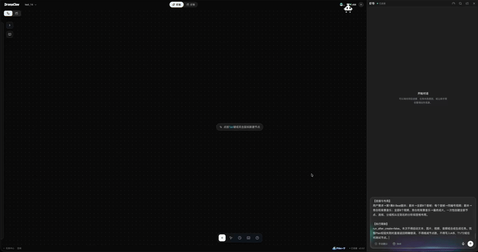
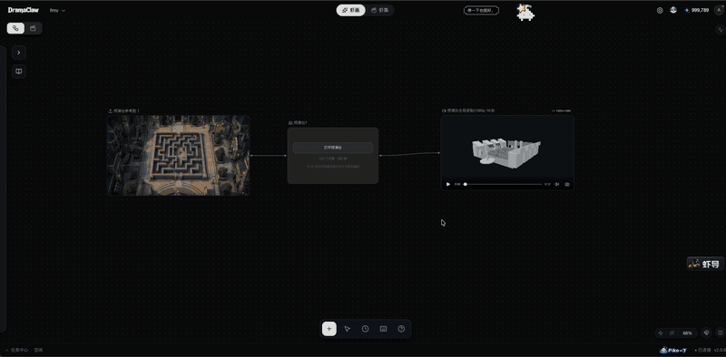
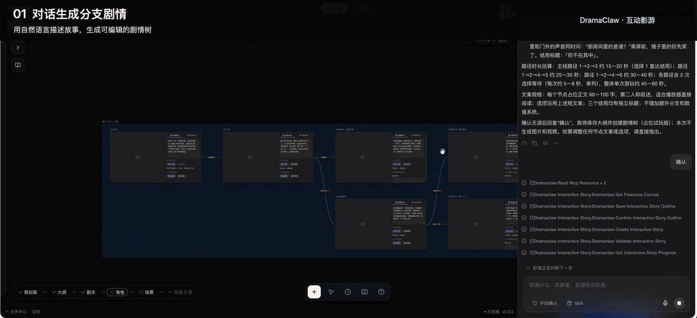
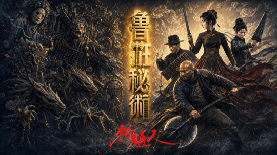
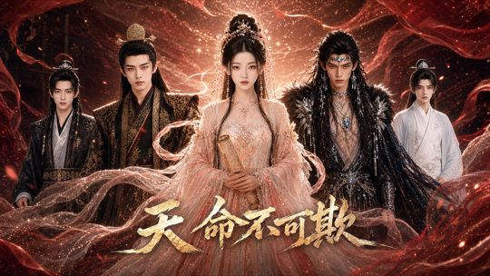
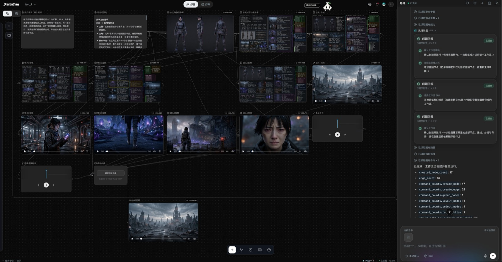
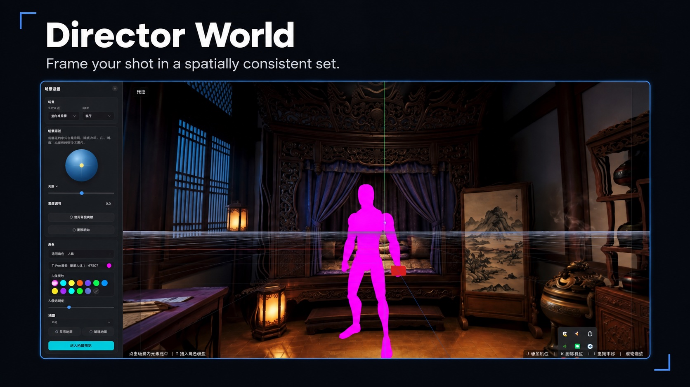
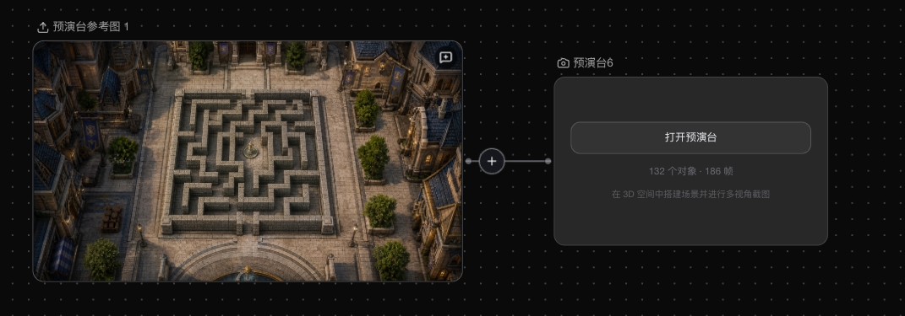
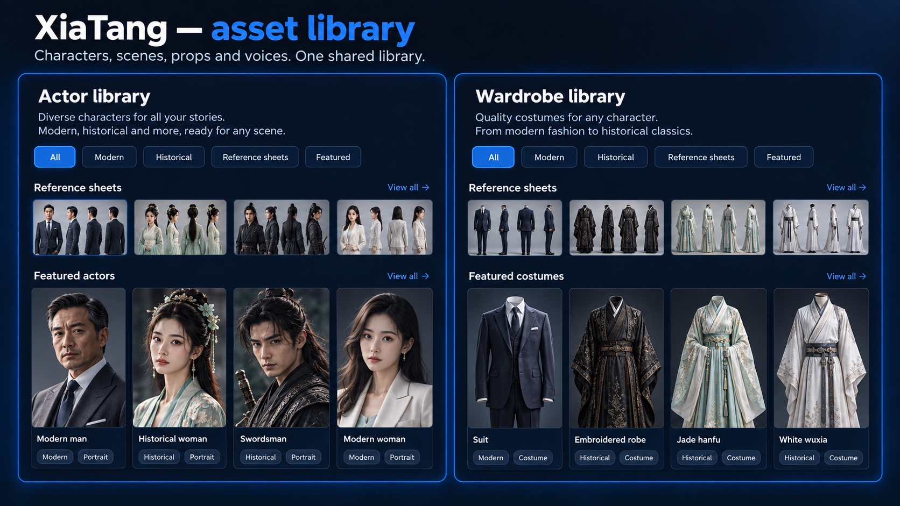
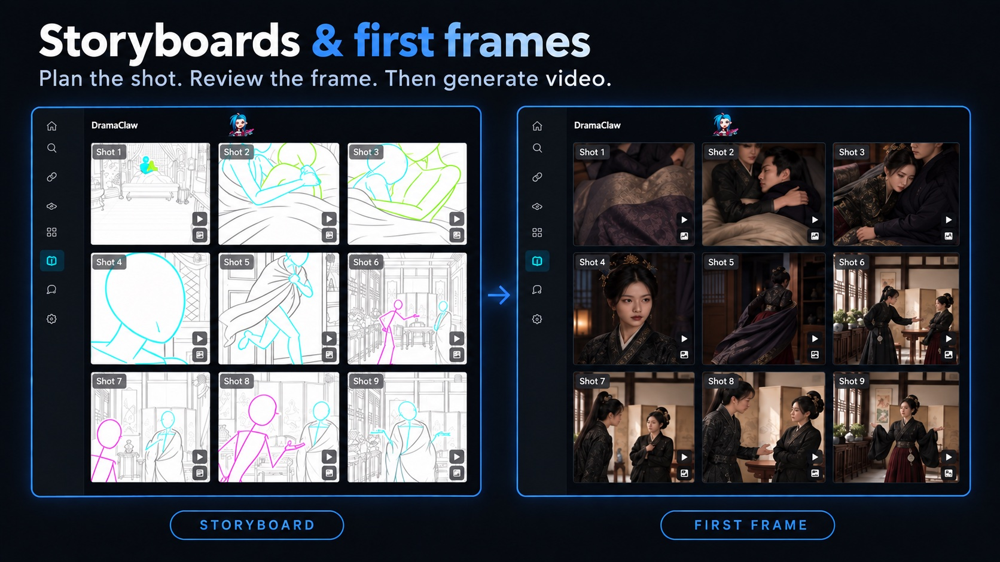

<div align="center">

<!-- TBD: thay bằng logo chính thức assets/logo.svg -->
<h1>DramaClaw</h1>

## Make Your Own DC.

<p align="left">

Họ nói bạn đã lỗi thời.<br/>
Có lẽ chính cái ý tưởng "đi làm thuê cho người khác" mới là thứ lỗi thời.<br/>
<br/>
Trong thời đại AI, câu hỏi thật sự không phải là máy móc có thay thế con người hay không.<br/>
Câu hỏi thật sự là:<br/>
Ai sở hữu máy móc?<br/>
Ai sở hữu quy trình?<br/>
Ai sở hữu năng lực sản xuất công nghiệp hóa?<br/>
<br/>
Nếu câu trả lời luôn là các ông lớn công nghệ,<br/>
thì AI không phải là trao quyền.<br/>
Nó chỉ là một bức tường mới.<br/>
<br/>
Tôi là Eric.<br/>
<br/>
Đây không phải một bản demo.<br/>
Không phải đồ chơi.<br/>
Không phải bản cắt xén.<br/>
<br/>
Đây là dây chuyền sản xuất phim drama công nghiệp hóa mà chính đội ngũ chúng tôi chạy mỗi ngày.<br/>
Từ kịch bản đến storyboard, từ tài sản đến phim hoàn chỉnh — trọn vẹn cả chuỗi.<br/>
<br/>
Vì con người không phải trâu ngựa.<br/>
Vì sức sáng tạo là phòng tuyến cuối cùng của nhân loại.<br/>
<br/>
Điều DramaClaw muốn làm rất đơn giản:<br/>
<br/>
<strong>Phá bỏ bức tường.</strong><br/>
<br/>
Đưa năng lực sản xuất phim drama công nghiệp hóa mà trước đây chỉ các ông lớn mới có<br/>
vào tay những người sáng tạo bình thường.<br/>
<br/>
Mã nguồn đã ở đây.<br/>
Nếu bạn thấy đồng cảm, hãy để lại một ⭐.<br/>
Chúng tôi sẽ tiếp tục phá tường.

</p>

<p align="left">

<strong>Và đúng vậy, bạn có thể kiếm tiền với nó.</strong><br/>
DramaClaw dùng giấy phép <a href="../LICENSES/Elastic-2.0.txt">Elastic License 2.0</a>. Chạy nó, sửa nó, bán những gì bạn xây bằng nó —<br/>
phiên bản độc lập được dùng thương mại miễn phí, không cần xin phép.<br/>
Chúng tôi chỉ xin một điều: một dòng nhỏ "Powered by DramaClaw" ở góc giao diện của bạn.<br/>
Cánh cửa duy nhất còn đóng là đóng gói nó thành SaaS lưu trữ để bán cho người khác; giấy phép đó chưa mở.<br/>
Lý do và các câu hỏi thường gặp: <a href="https://github.com/dramaclaw/dramaclaw/issues/475">#475</a>.

</p>

<br/>

[](../LICENSES/Elastic-2.0.txt)
[](https://github.com/dramaclaw/dramaclaw/stargazers)
[](https://github.com/dramaclaw/dramaclaw/releases)
[](#quick-start)

[English](../README.md) &nbsp;|&nbsp; [简体中文](./README_zh.md) &nbsp;|&nbsp; **Tiếng Việt** &nbsp;|&nbsp; [ไทย](./README_th.md) &nbsp;|&nbsp; [Website](https://dramaclaw.ai) &nbsp;|&nbsp; [Tài liệu](../docs/en/README.md) &nbsp;|&nbsp; [Bắt đầu nhanh](../docs/en/getting-started/quickstart.md)

</div>

<br/>

<p align="center">
  
</p>

<p align="center">
  <sub>🎬 Trailer: <a href="https://www.bilibili.com/video/BV1iQV26cE4S">Bilibili</a> &nbsp;·&nbsp; <a href="https://www.youtube.com/watch?v=64apa3maxK0">YouTube</a></sub>
</p>

<br/>

## DramaClaw là gì?

DramaClaw là một **dây chuyền sản xuất phim drama AI có thể tự lưu trữ**: từ bản thảo đến các tập phim hoàn chỉnh, từ một dòng yêu cầu đến một bộ phim ngắn. Một agent và một bảng vẽ vô hạn dùng chung một thư viện tài sản:

- **Xia Director** — agent tích hợp sẵn. Mô tả điều bạn muốn; nó lập kế hoạch workflow, bố trí các node và chạy chúng sau khi bạn xác nhận.
- **XiaHua** — bảng vẽ vô hạn (infinite canvas). Tạo, chỉnh sửa và kết nối hình ảnh, video, âm thanh, bối cảnh 3D, truyện tương tác và kịch bản dưới dạng node.
- **Series (XiaJi)** — pipeline. Thả vào một tiểu thuyết hoặc kịch bản; DramaClaw cấu trúc hóa câu chuyện, viết kịch bản, vẽ storyboard, lồng tiếng lời thoại và dựng thành phim.

Dùng bất kỳ model nào qua một gateway tương thích OpenAI, chạy trên chính máy của bạn, và giữ tư liệu trong tay bạn.

<p align="center">
  <a href="#quick-start"><b>🚀 Bắt đầu nhanh</b></a> &nbsp;·&nbsp;
  <a href="#whats-new"><b>🆕 Có gì mới</b></a> &nbsp;·&nbsp;
  <a href="#made-with-dramaclaw"><b>🎬 Tác phẩm</b></a> &nbsp;·&nbsp;
  <a href="#features"><b>✨ Tính năng</b></a> &nbsp;·&nbsp;
  <a href="#models"><b>🔌 Model</b></a> &nbsp;·&nbsp;
  <a href="#documentation"><b>📖 Tài liệu</b></a>
</p>

<br/>

## <a name="whats-new"></a>🆕 Có gì mới

Ba thứ chúng tôi đã xây cùng đội ngũ sản xuất của chính mình, nay đã có trên `main`.

### 🤖 Xia Director — từ một yêu cầu đến một workflow đang chạy

<p align="center">
  
</p>
<p align="center"><sub>Một yêu cầu → workflow được lập kế hoạch → các node trên canvas → tài sản được tạo → video được ghép.</sub></p>

- **Lập kế hoạch và chạy workflow trên canvas** — chuyển một yêu cầu sáng tạo thành đồ thị node, bố trí nó, và thực thi sau khi bạn xác nhận, kèm theo dõi tiến độ và khôi phục khi thất bại.
- **Danh mục workflow, Skill và Recipe** — workflow tích hợp cho phim drama ngắn, quảng cáo thương mại điện tử và nhân vật IP, nội dung mạng xã hội, anime Nhật Bản, hoạt hình phong cách LEGO và đối đầu trên sân khấu ngoài trời. Cài đặt, xuất và chia sẻ gói Skill, hoặc **nhập một `SKILL.md` / ZIP bên ngoài** và chuyển nó thành Skill gốc.
- **Dựng cả trang web** — yêu cầu một landing page hoặc microsite cho câu chuyện; nó trở thành một node HTML có thể chỉnh sửa, có lịch sử phiên bản và xuất ZIP độc lập.
- **Hiểu dự án của bạn** — kiểm tra tiến độ, triển khai tác vụ kịch bản và cảnh quay, tìm sản phẩm bàn giao còn thiếu và đề xuất bước tiếp theo.
- **Tùy chọn "bộ não"** — mặc định đi kèm runtime Codex; trỏ Agent tới bất kỳ model bên thứ ba nào hỗ trợ OpenAI Responses API và gọi công cụ, độc lập với các kênh media của bạn.
- **Làm việc từ các agent khác** — [Agent Kit](../agent-kit/README.md) cung cấp cùng các workflow qua MCP cho Codex, Claude Code, OpenClaw, WorkBuddy và bất kỳ MCP client stdio nào.

### 🎥 Sân khấu đạo diễn 3D (Previz) — dàn cảnh trước khi tạo `beta`

<p align="center">
  
</p>
<p align="center"><sub>Ảnh tham chiếu → blockout 3D → nhân vật, camera và timeline → bản xem trước được ghi hình trở lại canvas.</sub></p>

Một sân khấu previz trong trình duyệt, nằm trên canvas dưới dạng node. Chốt không gian, dàn cảnh và khung hình trước, rồi đưa kết quả vào khâu tạo ảnh và video.

- **Dựng bối cảnh blockout** — tạo bối cảnh 3D từ ảnh tham chiếu; thả đạo cụ và chúng sẽ đặt lên bất kỳ bề mặt nào bên dưới.
- **Nhân vật và chuyển động** — ma-nơ-canh với năm dáng người, đặt từ bản đồ nhìn từ trên xuống; chu kỳ bước đi theo đường di chuyển trên timeline đa track.
- **Camera và cắt cảnh** — tiêu cự, kích thước cảm biến và vị trí cho từng camera; một **program track** để cắt giữa các camera (phím số cắt trực tiếp) với màn hình giám sát theo bản dựng.
- **Track âm thanh** — nhập âm thanh từ file cục bộ hoặc node phía trước, xem dạng sóng và trộn vào bản ghi hình.
- **Trở lại canvas** — chụp khung hình hoặc ghi hình bản cắt program vào các node được kết nối để làm tham chiếu cho lần tạo tiếp theo.

### 🔀 Truyện tương tác — lựa chọn của khán giả định hình câu chuyện `beta`

<p align="center">
  
</p>
<p align="center"><sub>Tạo truyện phân nhánh, biên tập trên canvas, phát tương tác và nhiều kết thúc.</sub></p>

- **Lập kế hoạch truyện với AI** — một yêu cầu trở thành đề cương và cốt truyện phân nhánh có thể chỉnh sửa, với điểm lựa chọn, kết thúc và thời lượng dự kiến cho từng tuyến.
- **Phân nhánh trực quan trên canvas** — sắp xếp các đoạn truyện, video và lựa chọn; chỉnh sửa lời thoại, thứ tự lựa chọn và liên kết giữa các nhánh.
- **Biến và điều kiện** — mức độ thiện cảm, điểm số và các biến khác kiểm soát lựa chọn và quyết định kết thúc; có cả lựa chọn giới hạn thời gian và tuyến mặc định.
- **Sản xuất tư liệu tại chỗ** — tham chiếu nhân vật, cảnh và storyboard cùng video cho từng đoạn, tái sử dụng mọi tài sản trên canvas.
- **Chơi thử trước khi render** — chạy câu chuyện với tư liệu tạm, kiểm tra kết nối nhánh và tuyến có điều kiện, xem tỷ lệ đạt kết thúc và độ phủ tuyến truyện.
- **Xuất trình phát** — xuất trình phát HTML độc lập hoặc gói ngoại tuyến kèm video, phát theo nhánh, tiến độ và chơi lại.

<sub>Các tính năng `beta` đã có trên `main` và dùng được ngay hôm nay; giao diện và định dạng dữ liệu của chúng vẫn có thể thay đổi giữa các bản phát hành.</sub>

<br/>

<div align="center">

## <a name="made-with-dramaclaw"></a>🎬 Làm bằng DramaClaw

<sub>Những bộ phim drama ngắn thật do đội ngũ chúng tôi sản xuất trên chính dây chuyền này &mdash; bấm vào link để xem.</sub>

<table>
  <tr>
    <td align="center" width="205" valign="top">
      <br/>
      <b>归灵司</b><br/>
      <a href="https://nfg-web-assets.cdnfg.com/dramaclaw/guilingsi/guilingsi-ep01.mp4">▶ Tập 1</a>
    </td>
    <td align="center" width="205" valign="top">
      <br/>
      <b>鲁班</b><br/>
      <a href="https://nfg-web-assets.cdnfg.com/dramaclaw/luban/luban-ep01.mp4">▶ Tập 1</a>
    </td>
    <td align="center" width="205" valign="top">
      <br/>
      <b>师兄你怎么不舔了</b><br/>
      <a href="https://nfg-web-assets.cdnfg.com/dramaclaw/shixiong-butianle/shixiong-butianle-ep01.mp4">▶ Tập 1</a>
    </td>
  </tr>
  <tr>
    <td align="center" width="205" valign="top">
      <br/>
      <b>天命不可欺</b><br/>
      <a href="https://nfg-web-assets.cdnfg.com/dramaclaw/tianmingbukeqi/tianmingbukeqi-ep02.mp4">▶ Tập 02</a> &nbsp;·&nbsp; <a href="https://nfg-web-assets.cdnfg.com/dramaclaw/tianmingbukeqi/tianmingbukeqi-ep58.mp4">Tập 58</a>
    </td>
    <td align="center" width="205" valign="top">
      <br/>
      <b>乌龙仙途</b><br/>
      <a href="https://nfg-web-assets.cdnfg.com/dramaclaw/wulongxiantu/wulongxiantu-ep01.mp4">▶ Tập 1</a>
    </td>
    <td align="center" width="205" valign="top">
      <br/>
      <b>非遗㑇舞</b><br/>
      <a href="https://nfg-web-assets.cdnfg.com/dramaclaw/feiyi-zhouwu/feiyi-zhouwu.mp4">▶ Phát</a>
    </td>
  </tr>
</table>

<sub>Thêm clip:
<a href="https://nfg-web-assets.cdnfg.com/dramaclaw/3d-anime-montage-demo/3d-anime-montage-demo.mp4">3D 动漫混剪 demo</a> &nbsp;·&nbsp;
<a href="https://nfg-web-assets.cdnfg.com/dramaclaw/dongtai-dadou/dongtai-dadou.mp4">动态打斗</a></sub>

</div>

<br/>

## <a name="quick-start"></a>🚀 Bắt đầu nhanh

Bạn cần Docker với `docker compose`. Không cần GPU, cơ sở dữ liệu hay hàng đợi — model chạy phía sau gateway, trạng thái nằm trên ổ đĩa cục bộ.

```bash
git clone https://github.com/dramaclaw/dramaclaw.git
cd dramaclaw
cp .env.example .env          # set PROMPT_EXPORT_PASSWORD to a non-default value

docker compose -f docker-compose.release.yml pull
docker compose -f docker-compose.release.yml up -d
```

Mở <http://localhost:8080>, vào **Settings → Models & Channels**, và dán DC key của bạn (lấy tại <https://relayclaw.cdnfg.com>) — hoặc chuyển sang **Custom** để dùng các nhà cung cấp của riêng bạn. Vậy là xong.

File Compose phát hành chạy các image đa kiến trúc **v2.1.1** đã phát hành (`DRAMACLAW_VERSION=2.1.1`, `DRAMACLAW_GATEWAY_VERSION=v1.0.0-rc.24-dramaclaw.3`). Người dùng ở Trung Quốc đại lục có thể chuyển sang mirror ACR bằng `DRAMACLAW_IMAGE_PREFIX`.

<details>
<summary><b>Các cách chạy khác</b></summary>

<br/>

| Cách | Khi nào dùng | Lệnh | Hướng dẫn |
|---|---|---|---|
| **Image đã phát hành** | Dùng thử hoặc tự lưu trữ một bản phát hành | `docker compose -f docker-compose.release.yml up -d` | [Bắt đầu nhanh](../docs/en/getting-started/quickstart.md) |
| **Docker từ mã nguồn** | Chạy mã đã sửa của riêng bạn | clone [dramaclaw-gateway](https://github.com/dramaclaw/dramaclaw-gateway) cạnh repo này, rồi `docker compose up -d --build` | [Tự lưu trữ](../docs/en/guides/self-hosting.md) |
| **Phát triển cục bộ** | Phát triển DramaClaw với hot reload | `scripts/start-ce.sh` (API `:8780` + UI `:5173`; cần Python 3.11–3.12, `uv`, Node/pnpm, `ffmpeg`) | [Cài đặt](../docs/en/getting-started/installation.md) |

Nâng cấp từ một checkout cũ, ghim phiên bản, mở gateway đi kèm ra ngoài, hoặc dùng binary Codex của riêng bạn: xem [Hướng dẫn tự lưu trữ](../docs/en/guides/self-hosting.md) và [Xử lý sự cố](../docs/en/guides/troubleshooting.md).

</details>

<details>
<summary><b>Yêu cầu hệ thống</b></summary>

<br/>

| Hạng mục | Yêu cầu |
|---|---|
| **CPU / RAM** | ≥ 2 vCPU / 4 GB (suy luận model chạy trên gateway, không chạy cục bộ) |
| **GPU** | Không bắt buộc. Chỉ phần mở rộng tùy chọn `world` (voxel / toàn cảnh sang 3D) mới cần CUDA |
| **Hệ điều hành** | macOS (Apple Silicon / Intel), Windows (Docker Desktop + WSL2), Linux |
| **Cổng** | `8080` giao diện web · `8780` REST API · `3000` quản trị gateway đi kèm (mặc định chỉ localhost) |
| **Kho dữ liệu** | Không cần — không Postgres, Redis, Celery hay Ray. SQLite + file trên volume `ce-data` |
| **Mạng** | Truy cập ra ngoài tới `relayclaw.cdnfg.com` và/hoặc các nhà cung cấp bạn cấu hình |

</details>

<br/>

## <a name="features"></a>✨ Tính năng

### XiaHua — bảng vẽ vô hạn

<p align="center">
  
</p>
<p align="center"><sub>Một prompt gửi cho Xia Director (bên phải) đã trở thành workflow 17 node, 32 cạnh này (bên trái): brief → định hướng câu chuyện → tham chiếu nhân vật và bối cảnh → năm khung hình đầu → năm video cảnh quay → lồng tiếng và nhạc nền → bản dựng cuối.</sub></p>

- **Một canvas, mọi loại media** — node ảnh, video, âm thanh, kịch bản, ngữ cảnh beat, storyboard, phong cách, skill, toàn cảnh 360°, thế giới 3D, Previz, truyện tương tác, trang web và xuất. Kết nối tự do; mỗi node giữ lịch sử sinh nội dung riêng.
- **Công cụ ảnh** — tạo, chỉnh sửa, vẽ lại, mở rộng khung (outpaint), chiếu sáng lại, upscale, đa góc nhìn, chỉnh sửa theo mẫu, suy ngược prompt, phát hiện đánh dấu, và một **bức tường phong cách với 45 look phim drama ngắn**.
- **Công cụ video** — text / image / keyframe sang video, sinh nội dung tham chiếu toàn diện với tham chiếu từ file, link web và ngay trên canvas, chỉnh sửa video, xóa, upscale, tách âm thanh, mẫu chuyển động camera và phân tích cảnh quay; Seedance 2.5 có trong danh mục khuyến nghị.
- **Âm thanh và thiết kế giọng** — tổng hợp giọng nói, thư viện giọng, âm thanh tham chiếu và nhạc. **Mô tả giọng bằng lời**, nghe thử, rồi lưu vào vị trí giọng của nhân vật hoặc **My voices** (cần model âm thanh tương thích và `VOICE_DESIGN_ENABLED=1` cùng giới hạn hằng ngày trong [`.env`](../.env.example)).
- **Director World** — biến một ảnh thành bối cảnh 3D Gaussian Splat hoặc toàn cảnh scene-360, lấy khung hình trong trình xem, và tái sử dụng cùng một địa điểm nhất quán qua các cảnh quay.
- **Xây cho canvas lớn** — tab, dàn ý, minimap, bookmark vùng nhìn, căn chỉnh bám lưới, render theo mức chi tiết (level-of-detail), node nhóm, phím tắt, lịch sử phiên bản có khôi phục và khóa theo từng canvas.
- **Commit vào series** — xem trước tác động, rồi đưa một node hoặc cả một lô vào thư viện tài sản hoặc một tập; chiếu series ngược lại lên canvas.

<table>
  <tr>
    <td width="50%"><p align="center"><sub>Director World</sub></p></td>
    <td width="50%"><p align="center"><sub>Node Previz trên canvas</sub></p></td>
  </tr>
</table>

### Series (XiaJi) — pipeline

<p align="center">
  
</p>

Mỗi giai đoạn là một tác vụ độc lập với giao diện riêng — chạy theo thứ tự, bỏ qua bước, tiếp tục từ bất kỳ checkpoint nào, hoặc điều khiển chúng từ orchestrator của riêng bạn.

- **Nạp vào có cấu trúc** — các tập, nhân vật và bối cảnh lấy thẳng từ bản thảo hoặc kịch bản (hỗ trợ Fountain); không cần knowledge graph hay embedding.
- **Thư viện tài sản (XiaTang)** — nhân vật, bối cảnh, đạo cụ và giọng nói được sắp xếp theo mục đích; danh tính ổn định xuyên suốt các tập, chân dung và biến thể theo từng tập.
- **Lên kế hoạch tập và kịch bản** — phân đoạn chương, lập kế hoạch beat, cung truyện đa tập; các chế độ kịch bản chuyển thể / bám sát / dàn dựng với vòng lặp review-và-sửa.
- **Storyboard và khung hình đầu** — sinh nội dung cách điệu theo beat, chia lưới, chọn từ kho ảnh.
- **Lồng tiếng, ghép video và xuất** — giọng nói nhận biết cảm xúc, lắp ráp tập, xuất video + phụ đề và trọn bộ gói tài sản.
- **Phong cách hình ảnh** — trích xuất tham số phong cách từ một ảnh tham chiếu và áp dụng cho toàn bộ dự án.
- **Trung tâm tác vụ** — trạng thái, tiến độ, log, hủy / thử lại và tiếp tục từ checkpoint cho các lần chạy dài.

<table>
  <tr>
    <td width="50%"><p align="center"><sub>XiaTang — thư viện tài sản</sub></p></td>
    <td width="50%"><p align="center"><sub>Storyboard và khung hình đầu</sub></p></td>
  </tr>
</table>

<br/>

## 🤔 Tại sao chọn DramaClaw?

- **Một canvas hiểu phim drama, và một agent làm việc trên đó.** Các canvas node đa dụng nối được mọi thứ nhưng chẳng biết gì về tập, nhân vật hay cảnh quay. Các node và Skill của DramaClaw thì hiểu, và Xia Director lập kế hoạch rồi chạy chúng thay bạn.
- **Canvas *và* pipeline.** Khám phá tự do trên canvas, commit thứ hiệu quả vào series, chiếu series ngược lại lên canvas — một thư viện tài sản, một agent.
- **Không có hộp đen.** Mỗi giai đoạn là một tác vụ có thể tách rời với API riêng. Bỏ qua, tiếp tục, thay thế hoặc viết script cho bất kỳ bước nào.
- **Tự lưu trữ được, trung lập về model.** Bản thảo của bạn, nhân vật của bạn, model của bạn, máy chủ của bạn. Dùng các model đóng tiên tiến hoặc model open-weight; chuyển đổi bất cứ lúc nào.

### DramaClaw so với các sản phẩm khác

<sub>Chú giải: ✅ Đầy đủ · ◐ Một phần · ○ Dự kiến · ❌ Không có · — Chưa xác minh. Tên đối thủ được che một phần; dựa trên tài liệu sản phẩm và định vị công khai.</sub>

| Năng lực | L\*TV | R\*Hub | T\*Now | S\*ko | U\*dream | O\*II | J\*/K\* | **DramaClaw** |
|---|:--:|:--:|:--:|:--:|:--:|:--:|:--:|:--:|
| Agent tích hợp (lập kế hoạch workflow, điều phối canvas, thực thi) | ✅ | ✅ | ✅ | ○ | ✅ | ○ | ✅ | ✅ |
| Workflow Skill và Recipe (tái sử dụng, nhập, xuất, chia sẻ) | — | — | — | — | — | — | — | ✅ |
| Sân khấu đạo diễn 3D (dàn cảnh, chuyển động, camera, timeline, ghi hình) | — | — | — | — | — | — | — | ✅ beta |
| Series tương tác (phân nhánh, biến, nhiều kết thúc) | ◐ | ◐ | ◐ | ✅ | ◐ | ❌ | ❌ | ✅ beta |
| Bảng vẽ vô hạn (dạng node, khám phá tự do) | ✅ | ✅ | ✅ | ❌ | ✅ | ✅ | ✅ | ✅ |
| Hai đường ray (pipeline chính + khám phá trên canvas) | ❌ | ❌ | ❌ | ❌ | ❌ | ❌ | ❌ | ✅ |
| Xem trước storyboard (kịch bản → cảnh quay, bảng phân cảnh) | ◐ | ✅ | ◐ | ✅ | ◐ | ❌ | ❌ | ✅ |
| Thư viện tài sản (nhân vật / bối cảnh / đạo cụ / giọng nói) | ◐ | ❌ | ◐ | ✅ | ◐ | ○ | ❌ | ✅ |
| Nhất quán bối cảnh (biến thể, 360°, đa trạng thái) | ✅ | ◐ | ❌ | ❌ | ○ | ❌ | ❌ | ✅ |
| Thế giới đạo diễn (bối cảnh 360° / 3D, camera, khung hình) | ✅ | ◐ | ❌ | ❌ | ◐ | ❌ | ❌ | ✅ |
| Bàn giao cuối (đa cảnh quay, phụ đề / SRT, gói tài sản) | ✅ | ○ | ○ | ✅ | ✅ | ❌ | ❌ | ✅ |
| Sản xuất theo nhóm (chia sẻ, vai trò, tác vụ, chi phí) | ✅ | ✅ | ○ | ✅ | ○ | ○ | ○ | ✅ |
| Phong cách tùy chỉnh (mẫu, prompt, negative prompt) | ✅ | ◐ | ○ | ✅ | ◐ | ○ | ◐ | ✅ |
| Bạn đồng hành sáng tạo (nhân cách, nhắc nhở, phản hồi) | ❌ | ❌ | ❌ | ❌ | ❌ | ❌ | ❌ | ✅ |
| Mã nguồn công khai (tự lưu trữ, fork, tùy biến) | ❌ | ❌ | ❌ | ❌ | ❌ | ❌ | ❌ | ✅ |

<sub>✅ của DramaClaw chỉ nhánh `main`; các tính năng `beta` dùng được nhưng vẫn có thể thay đổi.</sub>

<br/>

## <a name="models"></a>🔌 Model & nhà cung cấp

Mọi model text, ảnh, video và âm thanh đều kết nối qua một **gateway tương thích OpenAI**. Chọn chế độ trong **Settings → Models & Channels**:

| Chế độ | Bạn làm gì | Phù hợp cho |
|---|---|---|
| **Official** (khuyến nghị) | Dán DC key của bạn từ [RelayClaw](https://relayclaw.cdnfg.com). Mọi ánh xạ model đã được cấu hình sẵn. | Bắt đầu nhanh |
| **Custom** | Một cú bấm khởi tạo [dramaclaw-gateway](https://github.com/dramaclaw/dramaclaw-gateway) đi kèm; thêm các kênh nhà cung cấp của riêng bạn. | Toàn quyền kiểm soát nhà cung cấp và chi phí |
| **Local + Official Hybrid** | Model official cho pipeline, cộng các kênh của riêng bạn (ví dụ một workflow ComfyUI cục bộ). | Kết hợp model cục bộ hoặc model chuyên biệt |

Gateway đi kèm là fork riêng của DramaClaw từ [New API](https://github.com/QuantumNous/new-api). Nó hiểu giao thức DC-Media và có sẵn adapter cho **ComfyUI · MiniMax / Hailuo · VolcEngine Doubao / Seedance · fal.ai · Alibaba · Kling · Jimeng · Vertex AI · Gemini · OpenAI / Sora · Suno** ([ma trận hỗ trợ](https://github.com/dramaclaw/dramaclaw-gateway/blob/main/docs/providers/en/README.md), [thêm nhà cung cấp](https://github.com/dramaclaw/dramaclaw-gateway/blob/main/CONTRIBUTING.md)).

Model của Agent được cấu hình riêng trong **Models & Channels → Agent model** và có thể theo kênh hiện tại hoặc dùng bất kỳ endpoint nào hỗ trợ OpenAI Responses API với gọi công cụ. Chi tiết: [Cấu hình model](../docs/en/getting-started/configuring-models.md).

<br/>

## <a name="documentation"></a>📖 Tài liệu

| | |
|---|---|
| **Bắt đầu** | [Bắt đầu nhanh](../docs/en/getting-started/quickstart.md) · [Cài đặt](../docs/en/getting-started/installation.md) · [Cấu hình model](../docs/en/getting-started/configuring-models.md) |
| **Tìm hiểu** | [Tổng quan tính năng](../docs/en/concepts/features.md) · [Kiến trúc](../docs/en/concepts/architecture.md) · [Sổ tay sản phẩm (Feishu)](https://neo-flying.feishu.cn/docx/JGNTdsjJuo748TxJkxecoYs2nth) |
| **Vận hành** | [Tự lưu trữ](../docs/en/guides/self-hosting.md) · [Xử lý sự cố](../docs/en/guides/troubleshooting.md) · [Dùng từ Claude Code (MCP)](../docs/en/guides/mcp-claude-code.md) |
| **Thêm** | [Tất cả tài liệu &rarr;](../docs/en/README.md) |

<br/>

## 🤝 Cộng đồng & Đóng góp

- 🐛 [Báo lỗi](https://github.com/dramaclaw/dramaclaw/issues/new?template=bug_report.yml) · 💡 [Đề xuất tính năng](https://github.com/dramaclaw/dramaclaw/issues/new?template=feature_request.yml) · 💬 [Thảo luận](https://github.com/dramaclaw/dramaclaw/discussions)
- Đọc [Hướng dẫn đóng góp](../CONTRIBUTING.md) và [Chính sách bảo mật](../SECURITY.md); bắt đầu với một [`good first issue`](https://github.com/dramaclaw/dramaclaw/labels/good%20first%20issue).

<br/>

## Sản xuất bởi

<p align="center">
  <picture>
    <source media="(prefers-color-scheme: dark)" srcset="../assets/partners/neoflying-lab-dark.png">
    
  </picture>
</p>

<p align="center"><sub>Logo là thương hiệu của chủ sở hữu tương ứng, được hiển thị với sự cho phép.</sub></p>

<br/>

## Giấy phép

[Elastic License 2.0](../LICENSES/Elastic-2.0.txt). Tự do sử dụng, sửa đổi, phân phối lại và bán những gì bạn xây bằng nó; giữ một dòng nhỏ "Powered by DramaClaw" trong giao diện của bạn. Hạn chế duy nhất là bạn không được cung cấp chính phần mềm này như một dịch vụ lưu trữ cho người khác. Xem [giải thích giấy phép](../docs/en/license.md), [tuyên bố cấp phép](https://github.com/dramaclaw/dramaclaw/issues/475), và `NOTICE` về yêu cầu thương hiệu và ghi nhận bên thứ ba.

<br/>

## Lịch sử Star

<a href="https://www.star-history.com/?repos=dramaclaw%2Fdramaclaw&type=date&legend=top-left">
 <picture>
   <source media="(prefers-color-scheme: dark)" srcset="https://api.star-history.com/chart?repos=dramaclaw/dramaclaw&type=date&theme=dark&legend=top-left&sealed_token=CWTXgm9EqgQmnSFWk0inuf_iZSml5r1nclyIsUyisWgYhUzFVJdI8G61vyFACIQe14weeMtjWSxpkzWdtFqyb93uV4uaRElaXWQv2kFxFFyL8KbUQBCOBUWXDtZc81J8YlaSiBVVXeOygLYZliOK4VQo4i1Ioqkxn5js-Bq0gbqVOH_wF3GCQ_EnMGLy" />
   <source media="(prefers-color-scheme: light)" srcset="https://api.star-history.com/chart?repos=dramaclaw/dramaclaw&type=date&legend=top-left&sealed_token=CWTXgm9EqgQmnSFWk0inuf_iZSml5r1nclyIsUyisWgYhUzFVJdI8G61vyFACIQe14weeMtjWSxpkzWdtFqyb93uV4uaRElaXWQv2kFxFFyL8KbUQBCOBUWXDtZc81J8YlaSiBVVXeOygLYZliOK4VQo4i1Ioqkxn5js-Bq0gbqVOH_wF3GCQ_EnMGLy" />
   
 </picture>
</a>

<br/><br/>

<div align="center">
  <sub>Xây dựng cho người kể chuyện. Mã nguồn công khai cho tất cả.</sub>
</div>
