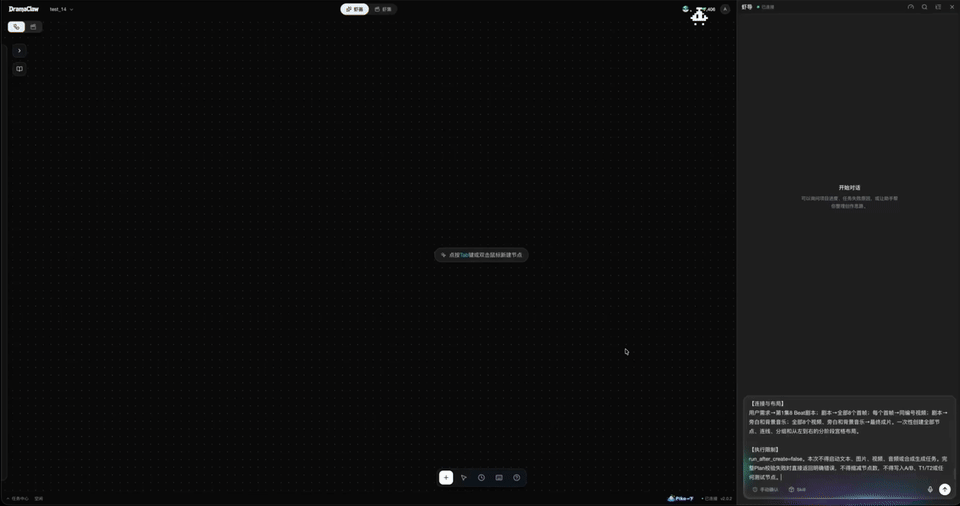
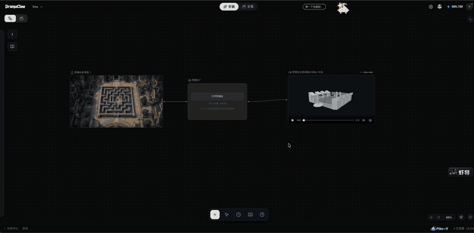
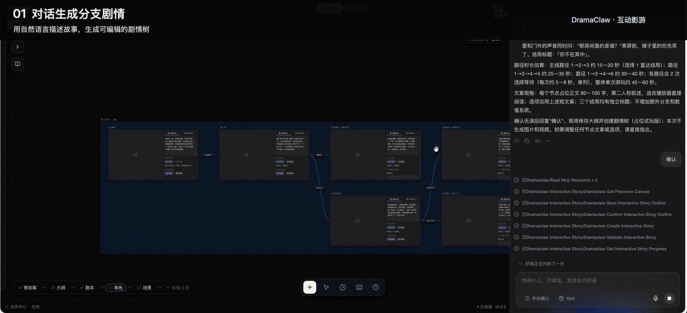
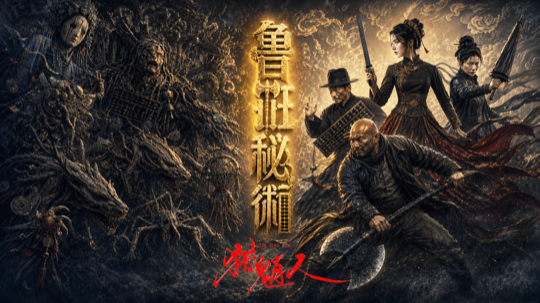
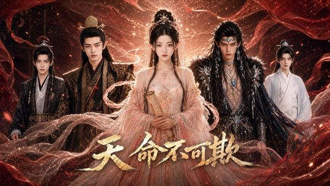
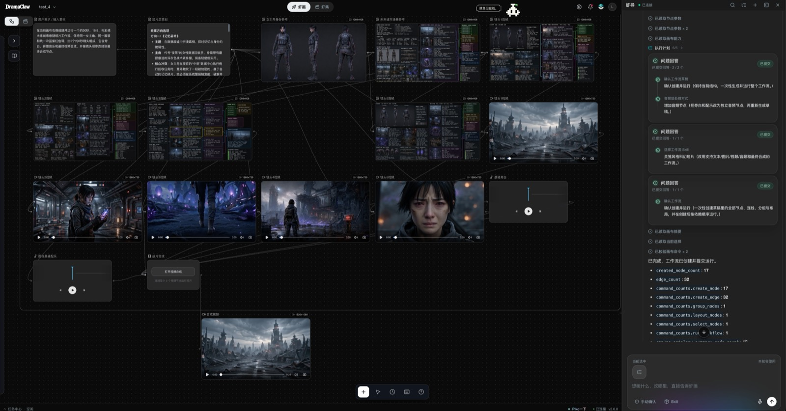
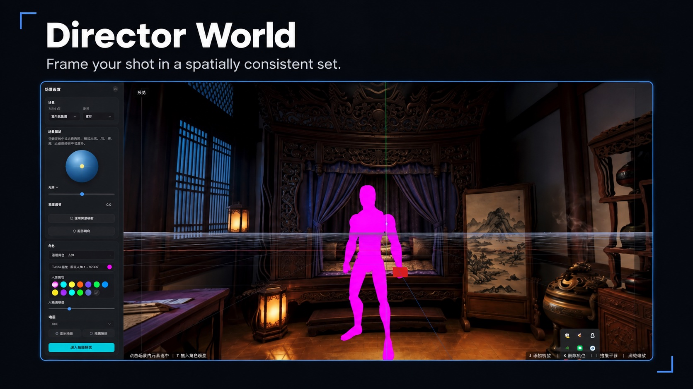
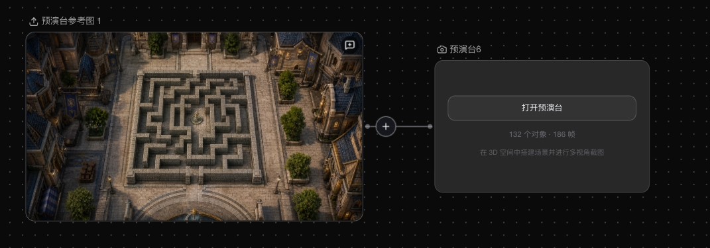
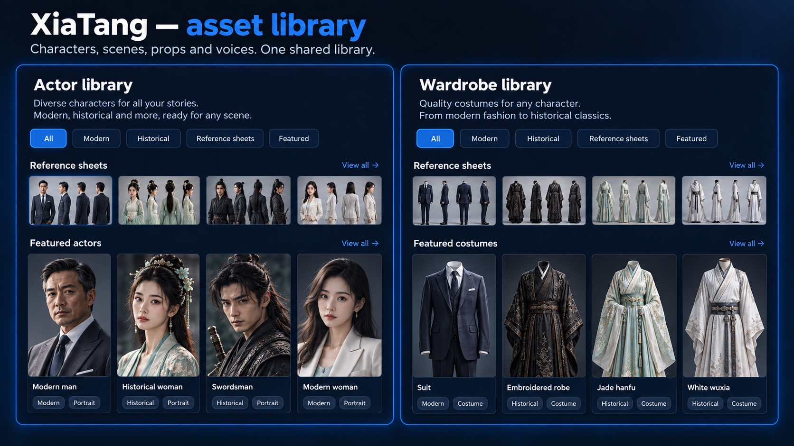
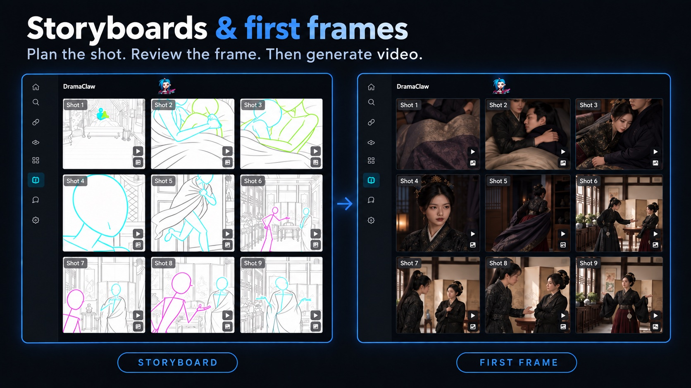

<div align="center">

<!-- TBD: 替换为正式 logo assets/logo.svg -->
<h1>DramaClaw</h1>

## Make Your Own DC.

<p align="left">

他们说你过时了。<br/>
也许是「打工」这件事过时了。<br/>
<br/>
AI 时代，真正的问题不是机器会不会替代人。<br/>
真正的问题是：<br/>
谁拥有机器？<br/>
谁拥有流程？<br/>
谁拥有工业化生产力？<br/>
<br/>
如果答案永远是大厂，<br/>
那 AI 就不是平权。<br/>
那只是新的高墙。<br/>
<br/>
我是 Eric。<br/>
<br/>
这不是 demo。<br/>
不是玩具。<br/>
不是阉割版。<br/>
<br/>
这是一条我们团队自己每天在跑的漫剧工业化生产线。<br/>
从脚本到分镜，从资产到成片，全链路。<br/>
<br/>
因为人不是牛马。<br/>
因为创造力，是人类最后的防线。<br/>
<br/>
DramaClaw 要做的事很简单：<br/>
<br/>
<strong>拆墙。</strong><br/>
<br/>
把过去只有大厂才有的漫剧工业化能力，<br/>
交到普通创作者手里。<br/>
<br/>
代码已就位。<br/>
认同的话，留下一颗 ⭐。<br/>
我们继续拆。

</p>

<p align="left">

<strong>对，你可以拿它赚钱。</strong><br/>
DramaClaw 采用 <a href="../LICENSES/Elastic-2.0.txt">Elastic License 2.0</a>。自己跑、自己改、自己卖，随便 ——<br/>
单机版本可以自由商用，不用申请，不用付费。<br/>
我们只有一个请求：在界面角落留一行小字「基于 DramaClaw」。<br/>
唯一还没开的门，是把它包成 SaaS 卖给别人；这条授权暂不开放。<br/>
原因和常见问题：<a href="https://github.com/dramaclaw/dramaclaw/issues/475">#475</a>。

</p>

<br/>

[](../LICENSES/Elastic-2.0.txt)
[](https://github.com/dramaclaw/dramaclaw/stargazers)
[](https://github.com/dramaclaw/dramaclaw/releases)
[](#quick-start)

[English](../README.md) &nbsp;|&nbsp; **简体中文** &nbsp;|&nbsp; [Tiếng Việt](./README_vi.md) &nbsp;|&nbsp; [ไทย](./README_th.md) &nbsp;|&nbsp; [官网](https://dramaclaw.ai) &nbsp;|&nbsp; [文档](../docs/zh/README.md) &nbsp;|&nbsp; [快速开始](../docs/zh/getting-started/quickstart.md)

</div>

<br/>

<p align="center">
  
</p>

<p align="center">
  <sub>🎬 预告片：<a href="https://www.bilibili.com/video/BV1iQV26cE4S">Bilibili</a> &nbsp;·&nbsp; <a href="https://www.youtube.com/watch?v=64apa3maxK0">YouTube</a></sub>
</p>

<br/>

## DramaClaw 是什么？

DramaClaw 是一条**可自托管的 AI 漫剧生产线**：从原稿到成片剧集，从一句需求到一条短片。智能体与无限画布共用同一个资产库：

- **虾导** —— 内置智能体。说出你想要什么，它规划工作流、在画布上铺好节点，经你确认后运行。
- **虾画** —— 无限画布。图片、视频、音频、3D 场景、互动剧、剧本都是节点，自由生成、编辑、连线。
- **虾集** —— 剧集流水线。丢进小说或剧本，DramaClaw 负责结构化故事、生成剧本、绘制分镜、配音并剪出成片。

任意模型都能通过 OpenAI 兼容网关接入；跑在你自己的机器上，素材留在你自己手里。

<p align="center">
  <a href="#quick-start"><b>🚀 快速开始</b></a> &nbsp;·&nbsp;
  <a href="#whats-new"><b>🆕 新功能</b></a> &nbsp;·&nbsp;
  <a href="#made-with-dramaclaw"><b>🎬 作品</b></a> &nbsp;·&nbsp;
  <a href="#features"><b>✨ 功能</b></a> &nbsp;·&nbsp;
  <a href="#models"><b>🔌 模型</b></a> &nbsp;·&nbsp;
  <a href="#documentation"><b>📖 文档</b></a>
</p>

<br/>

## <a name="whats-new"></a>🆕 新功能

我们自己的制作团队一直在用的三项能力，现已进入 `main`。

### 🤖 虾导 —— 从一句需求到跑起来的工作流

<p align="center">
  
</p>
<p align="center"><sub>一句需求 → 规划工作流 → 画布铺节点 → 生成素材 → 合成视频。</sub></p>

- **规划并运行画布工作流** —— 把创作需求转成节点图、自动布局，经你确认后执行，带进度跟踪与失败恢复。
- **工作流目录、Skill 与 Recipe** —— 内置短剧、电商与 IP 角色广告、社媒内容、日系动漫、乐高风动画、户外擂台对决等工作流。Skill 包可安装、导出、分享，也能**导入外部 `SKILL.md` / ZIP** 并转换为原生 Skill。
- **还能做网页** —— 让它做落地页或故事专题页，结果是可编辑的 HTML 节点，带版本历史，可导出自包含 ZIP。
- **懂你的项目** —— 查看进度、推进剧本与镜头任务、找出缺失的交付物并建议下一步。
- **大脑由你选** —— 默认使用内置 Codex 运行时；也可以给智能体单独指定任意支持 OpenAI Responses API 和工具调用的第三方模型，不影响媒体生成渠道。
- **外部智能体也能用** —— [Agent Kit](../agent-kit/README.md) 通过 MCP 把同一套工作流开放给 Codex、Claude Code、OpenClaw、WorkBuddy 及任意 stdio MCP 客户端。

### 🎥 3D 预演台 —— 先排好戏，再去生成 `beta`

<p align="center">
  
</p>
<p align="center"><sub>参考图 → 3D 白模场景 → 角色、机位与时间线 → 录制预演回到画布。</sub></p>

浏览器内的预演台，以节点形式挂在画布上。先锁定空间、站位和构图，再把结果交给图片与视频生成。

- **场景白模** —— 由参考图生成 3D 场景；拖入道具，松手即落到下方的表面上。
- **角色与动作** —— 五种体型的人偶，可在俯视图上选位；角色沿移动路径行走时自动播放步行动作，多轨时间线统一编排。
- **机位与切镜** —— 每台机位可调焦距、画幅与位置；**节目轨**在机位之间切换（数字键实时切），监视器跟随剪辑。
- **音频轨** —— 从本地文件或上游节点导入音频，显示波形，并混入录制结果。
- **回到画布** —— 截取画面或录制节目轨，写入相连节点，作为下一次生成的参考。

### 🔀 互动剧 —— 观众的选择决定剧情 `beta`

<p align="center">
  
</p>
<p align="center"><sub>分支剧情生成、画布编排、互动播放与多结局。</sub></p>

- **AI 剧情规划** —— 一句需求生成大纲和可编辑的分支叙事，含选择点、结局和每条路线的预计时长。
- **画布上可视化编排分支** —— 排布剧情片段、视频与选项；编辑台词、选项顺序和分支连线。
- **变量与条件** —— 好感度、分数等变量控制可选项、决定结局；支持限时选择与默认路线。
- **就地制作素材** —— 角色、场景、分镜参考与分段视频，画布上的素材全部可复用。
- **先试玩再出片** —— 用占位素材跑通剧情，校验分支连通与条件路径，查看结局达成率与路径覆盖率。
- **导出播放器** —— 导出独立 HTML 播放器或含视频的离线包，支持分支播放、探索进度与已解锁片段重看。

<sub>标 `beta` 的功能已在 `main` 中可用，界面与数据格式在后续版本中仍可能调整。</sub>

<br/>

<div align="center">

## <a name="made-with-dramaclaw"></a>🎬 用 DramaClaw 制作

<sub>我们团队用这条流水线亲手制作的真实短剧 &mdash; 点击链接即可播放。</sub>

<table>
  <tr>
    <td align="center" width="205" valign="top">
      <br/>
      <b>归灵司</b><br/>
      <a href="https://nfg-web-assets.cdnfg.com/dramaclaw/guilingsi/guilingsi-ep01.mp4">▶ 第 1 集</a>
    </td>
    <td align="center" width="205" valign="top">
      <br/>
      <b>鲁班</b><br/>
      <a href="https://nfg-web-assets.cdnfg.com/dramaclaw/luban/luban-ep01.mp4">▶ 第 1 集</a>
    </td>
    <td align="center" width="205" valign="top">
      <br/>
      <b>师兄你怎么不舔了</b><br/>
      <a href="https://nfg-web-assets.cdnfg.com/dramaclaw/shixiong-butianle/shixiong-butianle-ep01.mp4">▶ 第 1 集</a>
    </td>
  </tr>
  <tr>
    <td align="center" width="205" valign="top">
      <br/>
      <b>天命不可欺</b><br/>
      <a href="https://nfg-web-assets.cdnfg.com/dramaclaw/tianmingbukeqi/tianmingbukeqi-ep02.mp4">▶ 第 02 集</a> &nbsp;·&nbsp; <a href="https://nfg-web-assets.cdnfg.com/dramaclaw/tianmingbukeqi/tianmingbukeqi-ep58.mp4">第 58 集</a>
    </td>
    <td align="center" width="205" valign="top">
      <br/>
      <b>乌龙仙途</b><br/>
      <a href="https://nfg-web-assets.cdnfg.com/dramaclaw/wulongxiantu/wulongxiantu-ep01.mp4">▶ 第 1 集</a>
    </td>
    <td align="center" width="205" valign="top">
      <br/>
      <b>非遗㑇舞</b><br/>
      <a href="https://nfg-web-assets.cdnfg.com/dramaclaw/feiyi-zhouwu/feiyi-zhouwu.mp4">▶ 播放</a>
    </td>
  </tr>
</table>

<sub>更多片段：
<a href="https://nfg-web-assets.cdnfg.com/dramaclaw/3d-anime-montage-demo/3d-anime-montage-demo.mp4">3D 动漫混剪 demo</a> &nbsp;·&nbsp;
<a href="https://nfg-web-assets.cdnfg.com/dramaclaw/dongtai-dadou/dongtai-dadou.mp4">动态打斗</a></sub>

</div>

<br/>

## <a name="quick-start"></a>🚀 快速开始

只需要 Docker 和 `docker compose`。不需要 GPU、数据库或消息队列 —— 模型跑在网关后面，状态存在本地磁盘。

```bash
git clone https://github.com/dramaclaw/dramaclaw.git
cd dramaclaw
cp .env.example .env          # 把 PROMPT_EXPORT_PASSWORD 改成非默认值

docker compose -f docker-compose.release.yml pull
docker compose -f docker-compose.release.yml up -d
```

打开 <http://localhost:8080>，进入**设置 → 模型与渠道**，粘贴 DC key（到 <https://relayclaw.cdnfg.com> 获取）—— 或切到**自定义**接入你自己的供应商。就这样。

Release Compose 文件运行已发布的 **v2.1.1** 多架构镜像（`DRAMACLAW_VERSION=2.1.1`、`DRAMACLAW_GATEWAY_VERSION=v1.0.0-rc.24-dramaclaw.3`）。中国大陆用户可通过 `DRAMACLAW_IMAGE_PREFIX` 切换到阿里云 ACR 镜像。

<details>
<summary><b>其他运行方式</b></summary>

<br/>

| 方式 | 适用场景 | 命令 | 指南 |
|---|---|---|---|
| **发布镜像** | 试用或自托管某个发布版本 | `docker compose -f docker-compose.release.yml up -d` | [快速开始](../docs/zh/getting-started/quickstart.md) |
| **源码 Docker** | 运行自己修改过的代码 | 把 [dramaclaw-gateway](https://github.com/dramaclaw/dramaclaw-gateway) clone 到本仓库旁边，然后 `docker compose up -d --build` | [自托管](../docs/zh/guides/self-hosting.md) |
| **本地开发** | 热重载开发 DramaClaw | `scripts/start-ce.sh`（API `:8780` + 界面 `:5173`；需要 Python 3.11–3.12、`uv`、Node/pnpm、`ffmpeg`） | [安装](../docs/zh/getting-started/installation.md) |

从旧版 checkout 升级、固定版本、对外开放内置网关、使用自己的 Codex 二进制：见[自托管手册](../docs/zh/guides/self-hosting.md)和[故障排查](../docs/zh/guides/troubleshooting.md)。

</details>

<details>
<summary><b>系统要求</b></summary>

<br/>

| 项目 | 要求 |
|---|---|
| **CPU / 内存** | ≥ 2 vCPU / 4 GB（模型推理在网关侧，不在本机） |
| **GPU** | 不需要。仅可选的 `world` extra（体素 / 全景转 3D）需要 CUDA |
| **操作系统** | macOS（Apple Silicon / Intel）、Windows（Docker Desktop + WSL2）、Linux |
| **端口** | `8080` Web 界面 · `8780` REST API · `3000` 内置网关管理后台（默认仅本机） |
| **数据存储** | 无需 Postgres、Redis、Celery 或 Ray。SQLite + 文件，存于 `ce-data` 卷 |
| **网络** | 需能访问 `relayclaw.cdnfg.com` 和/或你配置的模型供应商 |

</details>

<br/>

## <a name="features"></a>✨ 功能

### 虾画 —— 无限画布

<p align="center">
  
</p>
<p align="center"><sub>对右侧的虾导说一句话，左侧画布上就长出了这张 17 个节点、32 条连线的工作流：需求 → 故事方向 → 角色与场景参考 → 五个镜头首帧 → 五段镜头视频 → 旁白与配乐 → 成片合成。</sub></p>

- **一张画布，所有媒介** —— 图片、视频、音频、剧本、节拍上下文、分镜、风格、技能、360° 全景、3D 世界、预演台、互动剧、网页与导出节点。任意连线，每个节点保留自己的生成历史。
- **图片工具** —— 生成、编辑、重绘、扩图、重打光、放大、多视角、模板编辑、反推提示词、标记检测，以及**内置 45 种漫剧风格的风格墙**。
- **视频工具** —— 文生 / 图生 / 首尾帧生视频，全能参考生成支持文件、网页链接和画布内素材做参考，视频编辑、擦除、放大、人声分离、运镜模板与镜头分析；推荐目录已含 Seedance 2.5。
- **音频与声音设计** —— 语音合成、声线库、参考音频与音乐生成。**用文字描述一个声音**，试听后保存到角色声线插槽或「我的音色」（需配置兼容的音频模型，并在 [`.env`](../.env.example) 中设置 `VOICE_DESIGN_ENABLED=1` 及每日额度）。
- **导演世界** —— 把图片变成 3D 高斯片场或场景 360 全景，在查看器里取景，同一场景跨镜头保持一致。
- **为大画布而生** —— 画布分页、元素大纲、小地图、视口书签、吸附对齐、分级渲染、分组节点、快捷键、历史版本回滚与画布级锁。
- **提交回剧集** —— 先预览影响，再把单个节点或整批结果写入资产库或某一集；也能把剧集投影回画布。

<table>
  <tr>
    <td width="50%"><p align="center"><sub>导演世界</sub></p></td>
    <td width="50%"><p align="center"><sub>画布上的预演台节点</sub></p></td>
  </tr>
</table>

### 虾集 —— 剧集流水线

<p align="center">
  
</p>

每个阶段都是带独立接口的任务 —— 可以按顺序跑、跳步跑、从任意检查点续跑，也能接入你自己的编排器。

- **结构化导入** —— 从原稿或剧本（支持 Fountain）直接生成剧集、角色与场景，无需知识图谱或向量。
- **资产库（虾塘）** —— 角色、场景、道具与声线按用途组织；跨集稳定的身份、定妆照与分集变体。
- **剧集规划与剧本** —— 章节切分、节拍规划、多集弧线；自适应 / 忠实原文 / 分阶段三种剧本模式，带审校与修复循环。
- **分镜与首帧** —— 节拍驱动的风格化生成、宫格拆分、图池挑选。
- **配音、合成与导出** —— 情绪感知配音、整集合成、视频 + 字幕导出及完整素材包。
- **视觉风格** —— 上传参考图提取风格参数，应用到整个项目。
- **任务中心** —— 状态、进度、日志、取消 / 重试，长任务可从检查点续跑。

<table>
  <tr>
    <td width="50%"><p align="center"><sub>虾塘 —— 资产库</sub></p></td>
    <td width="50%"><p align="center"><sub>分镜与首帧</sub></p></td>
  </tr>
</table>

<br/>

## 🤔 为什么是 DramaClaw？

- **懂剧的画布，加一个在画布上干活的智能体。** 通用节点画布什么都能连，却不知道剧集、角色、镜头为何物。DramaClaw 的节点和 Skill 懂，虾导替你规划并运行它们。
- **画布与流水线并行。** 在画布上自由探索，把成立的结果提交进剧集，再把剧集投影回画布 —— 同一个资产库，同一个智能体。
- **没有黑箱。** 每个阶段都是可拆解、有独立 API 的任务。跳过、续跑、替换或脚本化任意一步。
- **可自托管，模型中立。** 你的原稿、你的角色、你的模型、你的服务器。闭源前沿模型或开放权重模型随时切换。

### DramaClaw 横向对比

<sub>图例：✅ 完整 · ◐ 部分 · ○ 规划中 · ❌ 无 · — 未核实。竞品名称部分打码；对比依据公开的产品文档与定位。</sub>

| 能力 | L\*TV | R\*Hub | T\*Now | S\*ko | U\*dream | O\*II | J\*/K\* | **DramaClaw** |
|---|:--:|:--:|:--:|:--:|:--:|:--:|:--:|:--:|
| 内置智能体（工作流规划、画布编排、执行） | ✅ | ✅ | ✅ | ○ | ✅ | ○ | ✅ | ✅ |
| 工作流 Skill 与 Recipe（复用、导入、导出、分享） | — | — | — | — | — | — | — | ✅ |
| 3D 预演台（站位、动作、机位、时间线、录制） | — | — | — | — | — | — | — | ✅ beta |
| 互动剧（分支、变量、多结局） | ◐ | ◐ | ◐ | ✅ | ◐ | ❌ | ❌ | ✅ beta |
| 无限画布（节点式、自由探索） | ✅ | ✅ | ✅ | ❌ | ✅ | ✅ | ✅ | ✅ |
| 双轨（主流水线 + 画布探索） | ❌ | ❌ | ❌ | ❌ | ❌ | ❌ | ❌ | ✅ |
| 分镜预览（剧本 → 镜头、分镜板） | ◐ | ✅ | ◐ | ✅ | ◐ | ❌ | ❌ | ✅ |
| 资产库（角色 / 场景 / 道具 / 声线） | ◐ | ❌ | ◐ | ✅ | ◐ | ○ | ❌ | ✅ |
| 场景一致性（变体、360°、多状态） | ✅ | ◐ | ❌ | ❌ | ○ | ❌ | ❌ | ✅ |
| 导演世界（360° / 3D 片场、机位、取景） | ✅ | ◐ | ❌ | ❌ | ◐ | ❌ | ❌ | ✅ |
| 成片交付（多镜头、字幕 / SRT、素材包） | ✅ | ○ | ○ | ✅ | ✅ | ❌ | ❌ | ✅ |
| 团队协作（共享、角色、任务、成本） | ✅ | ✅ | ○ | ✅ | ○ | ○ | ○ | ✅ |
| 自定义风格（模板、提示词、负面词） | ✅ | ◐ | ○ | ✅ | ◐ | ○ | ◐ | ✅ |
| 创作伙伴（人设、提醒、反馈） | ❌ | ❌ | ❌ | ❌ | ❌ | ❌ | ❌ | ✅ |
| 源码可见（自托管、可 fork、可定制） | ❌ | ❌ | ❌ | ❌ | ❌ | ❌ | ❌ | ✅ |

<sub>DramaClaw 的 ✅ 指 `main` 分支；`beta` 功能已可用，但仍可能调整。</sub>

<br/>

## <a name="models"></a>🔌 模型与供应商

所有文本、图片、视频、音频模型都通过 **OpenAI 兼容网关**接入。在**设置 → 模型与渠道**中选择模式：

| 模式 | 你需要做的 | 适合 |
|---|---|---|
| **官方**（推荐） | 粘贴从 [RelayClaw](https://relayclaw.cdnfg.com) 获取的 DC key，所有模型映射已预置。 | 快速上手 |
| **自定义** | 一键初始化内置的 [dramaclaw-gateway](https://github.com/dramaclaw/dramaclaw-gateway)，添加你自己的供应商渠道。 | 完全掌控供应商与成本 |
| **本地 + 官方混合** | 主流水线走官方模型，另加你自己的渠道（如本地 ComfyUI 工作流）。 | 混用本地或小众模型 |

内置网关是 DramaClaw 基于 [New API](https://github.com/QuantumNous/new-api) 的分支，使用 DC-Media 协议，已内置以下适配器：**ComfyUI · MiniMax / 海螺 · 火山引擎豆包 / Seedance · fal.ai · 阿里云 · 可灵 · 即梦 · Vertex AI · Gemini · OpenAI / Sora · Suno**（[支持矩阵](https://github.com/dramaclaw/dramaclaw-gateway/blob/main/docs/providers/en/README.md)、[新增供应商](https://github.com/dramaclaw/dramaclaw-gateway/blob/main/CONTRIBUTING.md)）。

智能体模型在**模型与渠道 → Agent 模型**中单独配置，可以跟随当前渠道，也可以使用任意支持 OpenAI Responses API 与工具调用的接口。详见[配置模型](../docs/zh/getting-started/configuring-models.md)。

<br/>

## <a name="documentation"></a>📖 文档

| | |
|---|---|
| **上手** | [快速开始](../docs/zh/getting-started/quickstart.md) · [安装](../docs/zh/getting-started/installation.md) · [配置模型](../docs/zh/getting-started/configuring-models.md) |
| **了解** | [功能总览](../docs/zh/concepts/features.md) · [架构](../docs/zh/concepts/architecture.md) · [产品使用手册（飞书）](https://neo-flying.feishu.cn/docx/JGNTdsjJuo748TxJkxecoYs2nth) |
| **运维** | [自托管](../docs/zh/guides/self-hosting.md) · [故障排查](../docs/zh/guides/troubleshooting.md) · [本地 Agent 接入（MCP）](../docs/zh/guides/local-agent-mcp.md) |
| **更多** | [全部文档 &rarr;](../docs/zh/README.md) |

<br/>

## 🤝 社区与贡献

- 🐛 [报告 Bug](https://github.com/dramaclaw/dramaclaw/issues/new?template=bug_report.yml) · 💡 [功能建议](https://github.com/dramaclaw/dramaclaw/issues/new?template=feature_request.yml) · 💬 [讨论区](https://github.com/dramaclaw/dramaclaw/discussions)
- 阅读[贡献指南](../CONTRIBUTING.md)与[安全策略](../SECURITY.md)；从 [`good first issue`](https://github.com/dramaclaw/dramaclaw/labels/good%20first%20issue) 开始。

<br/>

## 出品方

<p align="center">
  <picture>
    <source media="(prefers-color-scheme: dark)" srcset="../assets/partners/neoflying-lab-dark.png">
    
  </picture>
</p>

<p align="center"><sub>Logo 为其所有者的商标，经许可展示。</sub></p>

<br/>

## 许可证

[Elastic License 2.0](../LICENSES/Elastic-2.0.txt)。可以免费使用、修改、再分发，并出售你用它做出的作品；请在界面中保留一个小小的「Powered by DramaClaw」。唯一的限制是不得把软件本身作为托管服务提供给他人。详见[许可证说明](../docs/zh/license.md)、[授权声明](https://github.com/dramaclaw/dramaclaw/issues/475)，以及 `NOTICE` 中要求保留的品牌与第三方声明。

<br/>

## 星标走势

<a href="https://www.star-history.com/?repos=dramaclaw%2Fdramaclaw&type=date&legend=top-left">
 <picture>
   <source media="(prefers-color-scheme: dark)" srcset="https://api.star-history.com/chart?repos=dramaclaw/dramaclaw&type=date&theme=dark&legend=top-left&sealed_token=CWTXgm9EqgQmnSFWk0inuf_iZSml5r1nclyIsUyisWgYhUzFVJdI8G61vyFACIQe14weeMtjWSxpkzWdtFqyb93uV4uaRElaXWQv2kFxFFyL8KbUQBCOBUWXDtZc81J8YlaSiBVVXeOygLYZliOK4VQo4i1Ioqkxn5js-Bq0gbqVOH_wF3GCQ_EnMGLy" />
   <source media="(prefers-color-scheme: light)" srcset="https://api.star-history.com/chart?repos=dramaclaw/dramaclaw&type=date&legend=top-left&sealed_token=CWTXgm9EqgQmnSFWk0inuf_iZSml5r1nclyIsUyisWgYhUzFVJdI8G61vyFACIQe14weeMtjWSxpkzWdtFqyb93uV4uaRElaXWQv2kFxFFyL8KbUQBCOBUWXDtZc81J8YlaSiBVVXeOygLYZliOK4VQo4i1Ioqkxn5js-Bq0gbqVOH_wF3GCQ_EnMGLy" />
   
 </picture>
</a>

<br/><br/>

<div align="center">
  <sub>为讲故事的人而生。源码可见，向所有人开放。</sub>
</div>
